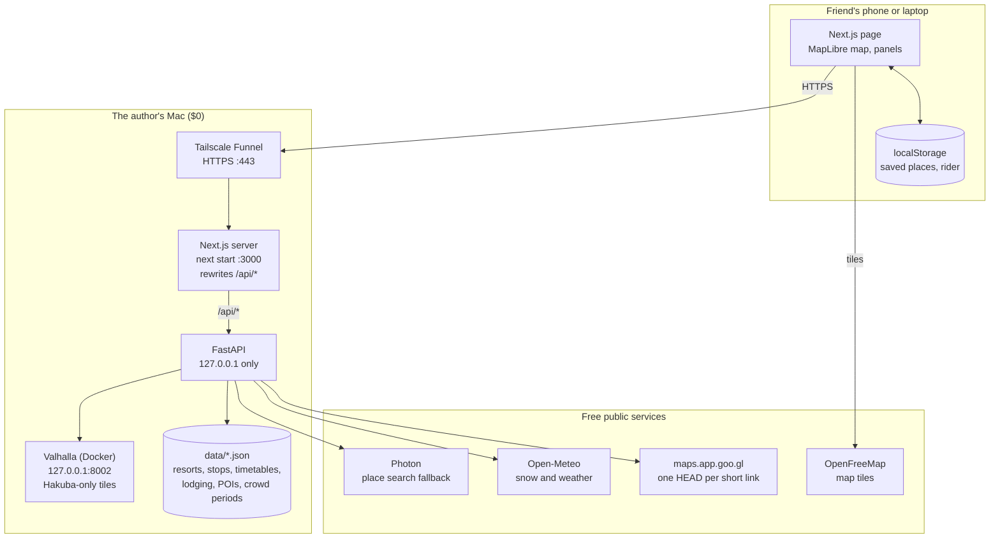

# Architecture: a top-down tour

A map of the project for someone new to it: what it does for a skier, which module does what and
where its code lives, how the pieces connect, one request traced end to end, and where the data
comes from. The SPECs say what each module *should* do. This page says what the code does today,
and lists every place where the two disagree (see [Follow-ups](#follow-ups)).

Checked against `main` on 2026-11-04. Status comes from `tasks/todo.md` (✅ per task) and the code,
not from the SPEC checkboxes, which are mostly left unticked.

## 1. What it does for a skier

The app is a Google-Maps-style trip planner for **Hakuba Valley** (10 ski resorts in Nagano, Japan).
Everything starts from one point, *the start*: your hotel, a bus stop, a pin you drop, or a pasted
Google Maps link.

1. **"How do I get to the slopes by bus?"** You search for your hotel ("tokyu", or 白馬東急) and open 🚌.
   The app shows the walk to the nearest shuttle stop, the next 3 departures, and when each bus
   reaches each resort. When this season's timetable isn't out yet, times are labelled **Expected**.
2. **"Which resort should I drive to today?"** In 🚗 all 10 resorts are ranked by the one thing you
   care about: drive time, fresh snow, snow depth, crowd level, terrain size or vertical drop.
   Each row shows the drive ETA, the snow, and an estimated crowd badge with its reasons.
   Tapping a row draws the route.
3. **"Where can I eat, and how far is it?"** In 🚗 or 🚶, pick a restaurant or a konbini and get a
   route with an ETA. You can add stops along the way.
4. **"Guide me there."** On a phone, **Start** turns the route into turn-by-turn navigation from
   live GPS. It reroutes when you leave the route and, on the bus, says when to get off. When you
   reach a resort you collect a **stamp** (the light game layer).

Saved places ("My hotel", favourites) and the rider profile stay in the browser only. There are no
accounts and no database.

## 2. Feature map

Paths are relative to `apps/web/src/` (web) and `services/api/src/hakuba_api/` (api).

| Module (SPEC) | What it does for the user | Web code | API code | Status |
|---|---|---|---|---|
| [resort-catalog](../SPEC-resort-catalog.md) | The 10 resorts, their lift bases and 100 bus stops on the map | `components/MapView.tsx` | `catalog/`, `GET /api/resorts` | Shipped |
| [place-search](../SPEC-place-search.md) | Find a hotel or place, or paste a Google Maps link, to set the start | `components/SearchBox.tsx`, `lib/recent-searches.ts` | `places/` (`index.py` local index, `photon.py` fallback, `gmaps_link.py`), `/api/places/suggest`, `/search`, `/lodging` | Shipped |
| [routing](../SPEC-routing.md) | Drive and walk routes, ETAs, turn list | `components/DirectionsPanel.tsx`, `lib/route-geo.ts` | `routing/` (Valhalla client), `/api/route`, `/routes`, `/route/path`, `/matrix` | Shipped |
| [snow-conditions](../SPEC-snow-conditions.md) | Snow depth and new snow per resort | shown in `components/ResortList.tsx` | `snow/` (Open-Meteo, 1 h cache), `GET /api/snow` | Partly built: model only, the "reported" source isn't built |
| [crowd-level](../SPEC-crowd-level.md) | "Crowd: high (est.)" with reasons | shown in `components/ResortList.tsx` | `crowd/heuristic.py`, `GET /api/crowd` (unused by the web) | Shipped (heuristic v1) |
| [bus-schedules](../SPEC-bus-schedules.md) | Next shuttle from the nearest stop, night bus | `components/BusPanel.tsx`, `StopList.tsx` | `bus/` (`query.py`, `season.py`, `check_sources.py`), `/api/bus/options`, `/night` | Shipped |
| [resort-ranking](../SPEC-resort-ranking.md) | Resorts sorted by one chosen factor | `components/DrivePanel.tsx`, `SortControls.tsx`, `ResortList.tsx` | `ranking/`, `GET /api/rank` | Partly built: prices known for 9 of 10 resorts, so the web still hides the price sort; night skiing known for 5 of 10 |
| [poi-destinations](../SPEC-poi-destinations.md) | Restaurants and konbini as destinations | `components/PoiList.tsx`, `DestinationPicker.tsx` | `pois/`, `GET /api/pois/nearby` | Shipped |
| [saved-places](../SPEC-saved-places.md) | Star places, lists, "My hotel", share link | `components/SavedPanel.tsx`, `SaveButton.tsx`, `lib/saved-places.ts`, `lib/saved-share.ts` | — (browser only) | Shipped |
| [pilot](../SPEC-pilot.md) | Turn-by-turn navigation from GPS, bus guidance | `components/PilotView.tsx`, `BusPilotView.tsx`, `lib/nav/` | uses `/api/route/path` for reroutes | Shipped; the real-phone walk test is still open |
| [game-theme](../SPEC-game-theme.md) | Pixel snowboarder, game-styled map, chiptune sounds | `lib/game/` (`sprites.ts`, `map-style.ts`, `sfx.ts`), `components/HeroMarker.tsx`, `TitleScreen.tsx` | — (browser only) | Shipped |
| [progression](../SPEC-progression.md) | Resort stamps, daily powder quests, rider card | `lib/game/` (`rider.ts`, `stamps.ts`, `quests.ts`), `components/QuestLog.tsx`, `RiderCard.tsx`, `CheckInButton.tsx` | — (browser only) | Shipped |
| [web-app](../SPEC-web-app.md) | The map page that ties it all together; state in the URL | `app/page.tsx`, `components/MapShell.tsx`, `BottomSheet.tsx`, `TripPanel.tsx`, `lib/url-state.ts` | — | Shipped; phone layout fixes ongoing (Tasks 86–88) |
| [deploy](../SPEC-deploy.md) | Friends open it on their phones over HTTPS for $0 | `next.config.ts` (rewrite, headers) | `scripts/serve-public.sh`, `infra/` | Phase A shipped; Phase B (Oracle VM) is an idea only |

**Where the SPECs and the code disagree** (each one is a [follow-up](#follow-ups)):

- **resort-ranking** (partly fixed in [PR #15](https://github.com/r03922123/jp_ski_map/pull/15)
  and [PR #19](https://github.com/r03922123/jp_ski_map/pull/19): `nightSkiing` is filled for 5
  resorts and `dayTicketJpy` for 9, from their own pages, and the web hides the price sort).
  The `price` sort and the `nightSkiing` filter existed, but `dayTicketJpy` and `nightSkiing` were
  `null` for all 10 resorts. Sorting by price quietly fell back to drive time (unknown values sort
  last), and turning on the night-skiing filter emptied the list. `dayTicketJpy` is still `null`
  for Cortina (the API still accepts `sort=price` and puts Cortina last), and `nightSkiing` is
  still `null` for Hakuba47, Happo-One, Iwatake, Norikura and Cortina, so the filter leaves them out.
- **crowd-level** (fixed in [PR #9](https://github.com/r03922123/jp_ski_map/pull/9),
  [PR #10](https://github.com/r03922123/jp_ski_map/pull/10),
  [PR #12](https://github.com/r03922123/jp_ski_map/pull/12) and
  [PR #13](https://github.com/r03922123/jp_ski_map/pull/13): the SPEC now says where 3-day
  weekends come from, ranks a holiday equal to a Saturday, says the web gets crowd through
  `/api/rank`, gives the real example, powder window and season edges, and says where
  peak-period weights live; the code now names every non-zero resort prior). `GET /api/crowd`
  exists, but the web app never calls it. Crowd reaches the screen inside `/api/rank`
  (section 4). The SPEC ranked a public holiday above a Saturday, but both weigh 0.30 in
  `CrowdConfig`. February 3-day weekends come from the day-type rule (any run of 3 or more weekend
  and holiday days), not from `data/crowd_periods.json` as the SPEC said. Three more SPEC lines
  disagreed with `crowd/heuristic.py`: the example output, the powder window (the past 24 h counts
  only for the snow report's own day), and the season edges, which also cover all of April. Two
  more: the SPEC put every weight in one config dict, but peak-period weights live in
  `data/crowd_periods.json`; and it said every contributing factor appears in `reasons`, but a
  resort prior below 0.20 added to the score with no reason.
- **snow-conditions** (fixed in [PR #9](https://github.com/r03922123/jp_ski_map/pull/9): the
  SPEC now marks it not built). `source: "reported"` exists only as a type value. Nothing parses
  the resort-reported snow page, so every depth is modelled.
- **place-search** (fixed in [PR #6](https://github.com/r03922123/jp_ski_map/pull/6)). The
  "Decision" at the top of the SPEC (Photon first, no lodging list) was replaced by the v1.2 local
  index and the v1.3 Overture lodging snapshot lower in the same file.
- **deploy** (fixed in [PR #6](https://github.com/r03922123/jp_ski_map/pull/6)). The SPEC-deploy
  diagram and its "one public port" bullet put the API on `:8010`; `scripts/serve-public.sh` uses
  `:8011`, and so does the spec's own later bullet.
- **SPEC.md** (fixed in [PR #6](https://github.com/r03922123/jp_ski_map/pull/6)). Its layout says
  `infra/docker-compose.yml` also runs `api` and `web`; it runs only `valhalla`. The package list
  misses `pois/` and `common/`. The "hosting target" open question was answered by SPEC-deploy.

## 3. System diagram

- **The browser only ever talks to `/api`** on its own site. Every upstream service sits behind
  FastAPI, which caches it (Open-Meteo 1 h) and rate-limits clients. Map tiles are the one
  exception: they go from OpenFreeMap straight to the browser.
- **Only port 443 is public.** Funnel forwards it to `:3000`; the API and Valhalla bind
  `127.0.0.1`. `tailscale funnel --https=443 off` takes the site down at once.
- **Offline, not per request:** the lodging and POI snapshots (`places/refresh_lodging.py`,
  `places/refresh_overture.py`, `pois/refresh_pois.py`), the Valhalla tile build
  (`infra/valhalla/build-hakuba.sh` from Geofabrik), and the timetable watch
  (`.github/workflows/timetable-watch.yml`, which opens an issue when the operator's page changes).
- **Types cross the boundary once:** FastAPI's OpenAPI schema → `pnpm gen:api` →
  `apps/web/src/lib/api-types.ts`. The web app never writes API types by hand.

## 4. One request end to end: the crowd level

What happens when a skier opens 🚗 Drive and taps **Crowd (estimated)** in the sort menu.

**In the browser**

1. `components/SortControls.tsx` (inside `DrivePanel.tsx`) changes the sort to `crowd`.
2. `components/MapShell.tsx` holds the options; its TanStack Query `useQuery(["rank", origin, rankOptions])`
   sees a new key and runs `fetchRank`. `placeholderData` keeps the old list on screen meanwhile.
3. `lib/api.ts` `fetchRank` calls `GET /api/rank?from=36.70,137.86&sort=crowd&date=…`.

**Across the boundary**

4. On the public site the request goes Funnel → `next start`. `next.config.ts` rewrites `/api/*`
   to the FastAPI service, so the browser never sees another origin (no CORS).
5. `main.py`: `BodyLimit` refuses large bodies, `limit_clients` applies the per-client rate limit
   (429 with `Retry-After`), and the request reaches the ranking router.

**In the API** (`ranking/router.py` `get_rank`, three inputs gathered with FastAPI `Depends`)

6. **Drive times.** `routing/client.py` sends one matrix request to Valhalla: the start → every
   resort's lift bases. The nearest base per resort is kept.
7. **Snow.** `crowd/router.py` `get_snow_by_resort` → `snow/router.py` (1 h `TtlCache`) →
   Open-Meteo. If Open-Meteo is down, crowd is still computed, just without the powder factor.
8. **Crowd.** `crowd/heuristic.py` `HeuristicCrowdSource.estimate` adds up, per resort:
   day type (3-day weekend 0.35, holiday or Saturday 0.30, Sunday 0.20, via the `holidays`
   package) + the strongest matching peak period in `data/crowd_periods.json` + powder
   (≥ 20 cm new: +0.15) + a fixed resort prior (Happo-One 0.25 … Jigatake 0) − 0.15 at the
   season's edges. It clamps the result to 0–1 and maps it to a level
   (< 0.3 low, < 0.55 medium, < 0.8 high, else very high). Every non-zero term becomes a reason.
9. `ranking/rank.py` `rank` sorts by the crowd score (lower is better; unknowns last; drive
   time breaks ties) and returns `RankedResort` objects, serialised as camelCase JSON.

**Back in the browser**

10. `components/ResortList.tsx` shows "Crowd: very high (est.)" on each row. Under **Details**,
    it lists the reasons and every factor's raw value.

A worked example (run against the real code): Happo-One on Saturday 14 Feb 2026 scores
0.30 (Saturday) + 0.25 (Lunar New Year week) + 0.25 (large resort) = **0.80, very high**.
Jigatake on Wednesday 18 Feb scores 0.25, **low**, with "Lunar New Year week" as its only reason.

If Valhalla is down, `/api/rank` returns 503 (`routing_unavailable`) and the Drive panel shows an
error. Crowd disappears with it, even though the crowd estimate itself doesn't need Valhalla,
because the two travel in one response. Each panel fetches on its own, so one panel's error
doesn't blank the others.

## 5. Where the data comes from

The code is MIT. The data keeps its own licence; [DATA-LICENSES.md](../DATA-LICENSES.md) is the
source of truth.

| Data | File | Source | Licence |
|---|---|---|---|
| Lodging (146) and POIs (87) | `data/lodging_osm.json`, `data/poi_osm.json` | OpenStreetMap via Overpass (snapshot) | ODbL 1.0 |
| Lodging (755) | `data/lodging_overture.json` | Overture Maps Places (snapshot) | CDLA-Permissive-2.0; Apache-2.0 for Foursquare records |
| Road network | Valhalla tiles, built at setup, not committed | OpenStreetMap via Geofabrik | ODbL 1.0 |
| Map tiles | fetched at runtime | OpenFreeMap / OpenMapTiles | ODbL (OSM data) |
| Place search fallback | queried at runtime | Photon (komoot) | ODbL (OSM data) |
| Snow and weather | queried at runtime | Open-Meteo | CC BY 4.0 |
| Resorts, stops, stop evidence | `data/resorts.json`, `data/bus_stops.json`, `data/bus/stop_evidence.json` | compiled for this project; coordinates from OpenStreetMap and Overture Maps Places, except 41 My Maps pins | ODbL 1.0, whole file ([ADR-0002](adr/0002-data-files-odbl.md), [ADR-0004](adr/0004-open-coordinate-sources.md)) |
| Crowd periods | `data/crowd_periods.json` | compiled by hand | facts for trip planning |
| Timetables (42 files, 2025–26) | `data/bus/timetables/` | transcribed from the operators' published timetables (`data/bus/sources.json`) | facts; originals not committed |

> **Open licensing risk: bus-stop coordinates.** [ADR-0002](adr/0002-data-files-odbl.md) labels
> `data/bus_stops.json`, `data/resorts.json` and `data/bus/stop_evidence.json` ODbL as whole
> files. In the stops and the stop evidence, one coordinate field mixes OpenStreetMap values with
> values from elsewhere, so share-alike can reach the whole file
> ([ODbL](https://opendatacommons.org/licenses/odbl/1-0/) §4.4.a, §4.4.b); `resorts.json`, whose
> coordinates are all from OpenStreetMap, gets the same label by choice. Overture Maps Places
> points keep their own permissive licence inside these files
> ([ADR-0004](adr/0004-open-coordinate-sources.md)). One group of stops is named but not covered,
> and it is the risk that remains in this public repository:
> - **The operator's Google My Maps pins** (41 stops, `bus/import_mymaps.py`): coordinates copied
>   out of Google Maps content. Whether Google's terms allow that is unresolved
>   ([ADR-0001](adr/0001-follow-ups-1-2-3-5.md) Decision 1).
>
> [PR #17](https://github.com/r03922123/jp_ski_map/pull/17) and
> [PR #18](https://github.com/r03922123/jp_ski_map/pull/18) re-located 10 stops from OpenStreetMap,
> and [PR #22](https://github.com/r03922123/jp_ski_map/pull/22) moved 7 more, including the last
> GSI stop, to OpenStreetMap and Overture; the rest need another source or permission (follow-up 1).

Timetables can be wrong or out of date. The app labels every estimate, and the README tells users
to check the official timetable.

## Follow-ups

Each item is small enough for its own PR. None is fixed by this page.

1. **Bus-stop licensing.** Decide what to do with the Photon, GSI and Google My Maps coordinates
   (credit, replace, or remove), then update `DATA-LICENSES.md`. Decided in
   [ADR-0001](adr/0001-follow-ups-1-2-3-5.md): credit OSM and GSI now, and replace the 56 Google
   My Maps pins in a later PR. Revised in [ADR-0002](adr/0002-data-files-odbl.md): the three
   files are ODbL as whole files, and the 2 GSI stops are re-located too. Credit ✅ done in
   [PR #14](https://github.com/r03922123/jp_ski_map/pull/14); 10 re-located from OSM in PRs
   [#17](https://github.com/r03922123/jp_ski_map/pull/17) and
   [#18](https://github.com/r03922123/jp_ski_map/pull/18); 7 more moved to OSM and Overture in
   [PR #22](https://github.com/r03922123/jp_ski_map/pull/22), which ends the GSI group
   ([ADR-0004](adr/0004-open-coordinate-sources.md), accepted in
   [PR #21](https://github.com/r03922123/jp_ski_map/pull/21)). 41 My Maps stops
   remain: 26 move to Overture in the next PR, and 15 wait on the owner's permission requests
   (ADR-0004 next step 3). Also open (ADR-0004 next step 2): `data/lodging_overture.meta.json`,
   and the code that writes it (`places/refresh_overture.py:31` and `:216`), still label every
   Overture record CDLA-Permissive-2.0; build the label from each record's sources, and link the
   licence texts from the app and the API docs.
2. **Ranking data gaps.** Fill `dayTicketJpy` and `nightSkiing` in `data/resorts.json`, or hide
   the price sort and night-skiing filter until there's data. Decided in
   [ADR-0001](adr/0001-follow-ups-1-2-3-5.md): fill `nightSkiing` for all 10 resorts; hide the
   price sort only if 2026–27 day-ticket prices aren't published. Night skiing for 5 resorts and
   hiding the price sort ✅ done in [PR #15](https://github.com/r03922123/jp_ski_map/pull/15): only
   9 resorts publish a 2026–27 price on their own site, and on different bases. The meaning of
   `dayTicketJpy` ✅ decided in [ADR-0003](adr/0003-day-ticket-price.md) (the adult 1-day window
   price for the main season, without the card deposit), and 9 resorts filled ✅ in
   [PR #19](https://github.com/r03922123/jp_ski_map/pull/19). Still open: Cortina's price, because
   its own site shows a maintenance page, and the price sort comes back once it has one; and
   `nightSkiing` for Hakuba47, Happo-One, Iwatake, Norikura and Cortina, whose own pages still don't
   say (re-checked 2026-11-06). Re-check them in December, with Kashimayari, whose `false` is read
   from its lift hours, and Iwatake's price, which comes from its early-bird news. The four
   leftovers outside PR #15's files ✅ done in
   [PR #16](https://github.com/r03922123/jp_ski_map/pull/16): the Drive panel's empty-list note
   says the night-skiing filter shows only resorts confirmed to run it, `README.md` no longer lists
   price as a Drive sort, `SPEC-resort-catalog.md` lists the 5 unknowns and the open meaning of
   `dayTicketJpy` under Open Questions, and `apps/web/tests/url-state.test.ts` checks that
   `?sort=price` falls back to drive time.
3. **Crowd: holiday vs Saturday.** Make the code match SPEC-crowd-level (holiday > Saturday), or
   change the SPEC. ✅ Done in [PR #10](https://github.com/r03922123/jp_ski_map/pull/10): the SPEC
   now says holiday = Saturday ([ADR-0001](adr/0001-follow-ups-1-2-3-5.md)); no code change.
4. **Crowd: February 3-day weekends.** Say in the SPEC that they come from the holiday calendar,
   not `crowd_periods.json`. ✅ Done in [PR #9](https://github.com/r03922123/jp_ski_map/pull/9).
5. **Crowd: `/api/crowd`.** Note in the SPEC that the web app gets crowd through `/api/rank`, or
   remove the unused endpoint. ✅ Done in [PR #10](https://github.com/r03922123/jp_ski_map/pull/10):
   the endpoint stays, and the SPEC notes the web reads crowd through `/api/rank`
   ([ADR-0001](adr/0001-follow-ups-1-2-3-5.md)).
6. **Snow: "reported" source.** Mark it as not built in SPEC-snow-conditions, or drop it from the model.
   ✅ Done in [PR #9](https://github.com/r03922123/jp_ski_map/pull/9): marked not built; the model
   keeps `"reported"` for the planned adapter.
7. **Place-search SPEC.** Mark the 2026-10-28 decision as replaced by v1.2/v1.3. ✅ Done in
   [PR #6](https://github.com/r03922123/jp_ski_map/pull/6).
8. **Deploy port.** Fix SPEC-deploy's diagram and "one public port" bullet to `:8011`. ✅ Done in
   [PR #6](https://github.com/r03922123/jp_ski_map/pull/6).
9. **SPEC.md layout.** Fix the compose line, add `pois/` and `common/`, and close the hosting
   open question. ✅ Done in [PR #6](https://github.com/r03922123/jp_ski_map/pull/6).
10. **SPEC checkboxes.** Tick the acceptance criteria that `tasks/todo.md` shows are done, or say
    in SPEC.md that `tasks/todo.md` is the status record. ✅ Done in
    [PR #9](https://github.com/r03922123/jp_ski_map/pull/9): SPEC.md now says `tasks/todo.md` is
    the status record; the boxes are left as they are.
11. **Crowd: example, powder and season edges.** Make SPEC-crowd-level's example output, powder
    window and season edges match `crowd/heuristic.py`, or change the code. ✅ Done in
    [PR #12](https://github.com/r03922123/jp_ski_map/pull/12): the SPEC now shows the real output,
    states the powder window and the season-edge dates, and names `_new_snow_for` and
    `_is_season_edge`; no code change.
12. **Crowd: config dict and silent resort prior.** Make SPEC-crowd-level's "every weight in one
    config dict" and "every contributing factor appears in `reasons`" match `crowd/heuristic.py`,
    or change the code. ✅ Done in [PR #13](https://github.com/r03922123/jp_ski_map/pull/13): the
    SPEC says peak-period weights live in `data/crowd_periods.json`, and the code now gives every
    non-zero resort prior a reason ("Moderately popular resort", "Less-visited resort"); no score
    changes.
