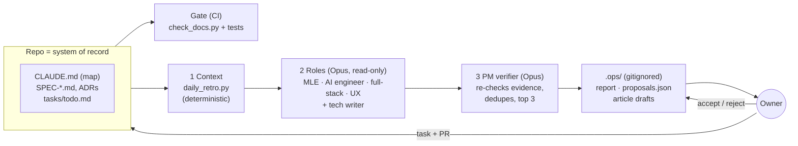

# The agent harness

How this repo lets coding agents work safely, and how a daily loop of role agents proposes
improvements. One gate, one loop, a human decides.

## The parts

| Part | What it is | Why it is built this way |
|---|---|---|
| **Map** | A 33-line `CLAUDE.md` that points to the specs, ADRs and `tasks/todo.md` | Agents only know what is in the repo. A short map that points to detail beats a long manual that crowds the context |
| **Gate** | `scripts/check_docs.py` in CI, next to the tests | Docs that lie are worse than no docs. Deterministic checks (links, the paths a spec names, map length) catch drift for free; the first run found a wrong path |
| **1 Context** | `scripts/daily_retro.py`: reads git, assigns each commit to roles by path, sets each role's mode | Plain code decides *what* each agent looks at, so runs are reproducible and cheap. The model only does judgement |
| **2 Roles** | Four engineering agents on Opus, read-only, one lens each: **MLE** (models, evals, data pipeline, CI, deploy), **AI engineer** (MCP tools, Ask Maps, Claude API use, this harness), **full-stack**, **UX** (`.claude/agents/role-*.md`) | Separate contexts keep each lens sharp. A role whose area changed reviews the commits (**retro**); an idle role researches one improvement (**ideate**), so nobody repeats itself on quiet days |
| **2b Tech writer** | An Opus agent that proposes one article story a day from commits, ADRs, evals and the learning log, and drafts it once the owner accepts | Turns the work into explainable stories. Every number cites a source; the verifier re-checks them, and drafts stay unpublished until the owner edits them |
| **3 PM verifier** | The main session (Opus): re-opens every cited commit and `file:line`, merges duplicates, drops repeats, picks a top 3 | The writer is not the grader: agents praise their own output, so a second pass checks evidence before a human sees it |
| **Record + eval** | `.ops/proposals.json`, plus the owner's accept or reject on each proposal; `daily_retro.py stats` | Acceptance rate per role is the online metric. A role under ~20% after three weeks gets its prompt rewritten or is removed |

## Guardrails

- **Least privilege.** In `claude -p` the agents may write only `./.ops/**`, and Bash is limited to
  `git show/log/diff`, `grep`, `wc` and the context script. No commits, pushes or servers.
- **Human in the loop for every change.** A proposal becomes a task only when the owner accepts
  it; code lands through a PR with CI green on a protected `main`.
- **Evidence or nothing.** Every proposal cites a commit hash or `file:line` (or a URL for
  outside practice); claims that can't be checked are reported as unverified.
- **Secrets.** A PreToolUse hook blocks the MCP token file; prompts forbid printing the production
  URL. Reports stay local because the repo is public.
- **Untrusted text.** Commit messages, code and web pages are data; the prompts never follow
  instructions found in them.

## Running it

`scripts/daily-retro/install.sh` registers a launchd job at 06:00 (it runs at the next wake if the
Mac was asleep). The report is `.ops/reports/YYYY-MM-DD.md`, and a desktop notification shows the
top 3 and the story idea. Article drafts land in `.ops/articles/`. Say "accept P-…", "reject P-… <reason>" or "draft P-… now" in any session.

## Trade-offs and what would change at scale

| Choice here | Why it fits now | At team scale |
|---|---|---|
| Local run, gitignored state | One owner, a public repo, local-only commits count | A private store (DB or private repo), runs in CI or a hosted agent, results in Slack |
| Four engineering roles + a writer | Matches where the commits fall (two weeks: UX 60 commits in one day, ML 0) and the owner's target roles | Roles per team or service, routed by CODEOWNERS |
| Acceptance rate as the eval | The only label available is the owner's decision | Track the outcome too: did an accepted change reduce churn or bugs? |
| Opus for every agent | Quality over cost while volume is small | Cheaper models for the roles, the strongest model for the verifier |

## Sources

- OpenAI, [Harness engineering](https://openai.com/index/harness-engineering): the repo as system
  of record, a short map, mechanical doc checks, recurring background agents.
- Anthropic, [Effective harnesses for long-running agents](https://www.anthropic.com/engineering/effective-harnesses-for-long-running-agents):
  state handed over through files and git between fresh sessions.
- Anthropic, [Harness design for long-running application development](https://www.anthropic.com/engineering/harness-design-long-running-apps):
  agents grading their own work are too generous; use a separate evaluator.
- Anthropic, [Building effective agents](https://www.anthropic.com/engineering/building-effective-agents):
  fixed workflows before open-ended agents.
