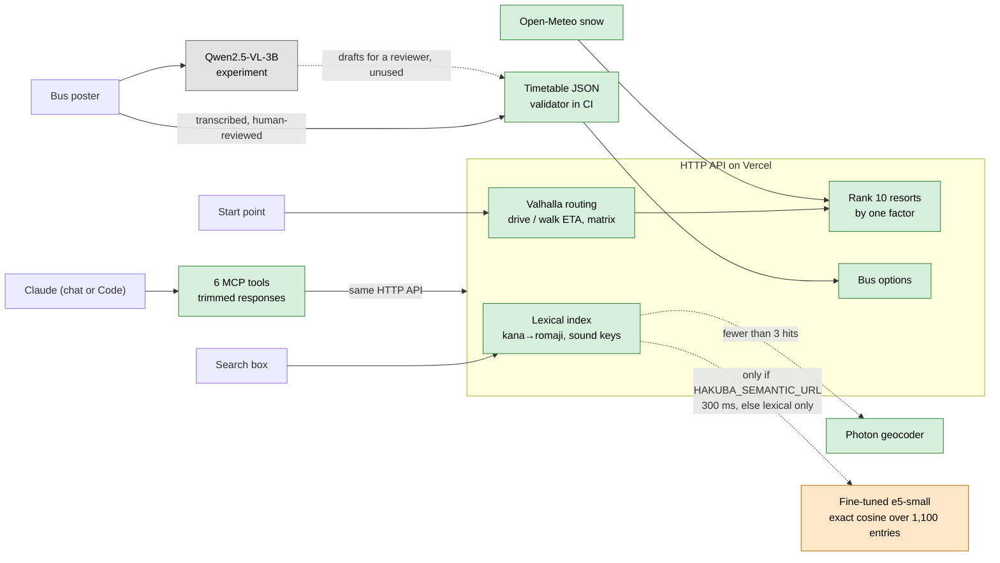

# ML and agents: a reader's tour

For an applied scientist, ML engineer or AI engineer who has 15 minutes for this repo. It shows where the models
sit, what each one is measured on, and the decisions worth checking. Each number is a copy and links to its
source of truth (a SPEC or an eval report); when they disagree, the source wins. Toy examples call the repo's real
functions, with output pasted from a run at `361cb08` (2026-11-24).

## 1. Where the models sit

Most of the product is deterministic. Learned models are either off in production or offline, and every one of
them has a simpler fallback that is served.



Green is served, orange is built but off in production, grey never runs in production.

## 2. Model cards

One row per component, after Google's [Model Cards](https://arxiv.org/abs/1810.03993): what it does, what it was
judged on, and whether it ships. ± is one standard error.

| Component | Approach | Judged on | Result | Status | Source |
|---|---|---|---|---|---|
| Place search | Lexical index: normalisation, kana→romaji, sound keys | `booking_eval.json`, 26 present + 4 absent hotels | 26/26 found, 4/4 absent left empty, 0 wrong | Served | [SPEC-place-search.md](../SPEC-place-search.md) |
| Semantic search | `multilingual-e5-small`, contrastive fine-tune on synthetic pairs, per-model threshold | `heldout_v2.json`, n=55, written before any result on it | hybrid − lexical hit@5 +0.036 ± 0.025, paired: not established | Off | [SPEC-place-search.md](../SPEC-place-search.md) v1.6, v1.7 |
| ~~Crowd level~~ | Hand-weighted heuristic (calendar, holidays, snow, resort size) | No labelled crowd data exists; unit tests pinned named cases | Never validated | Removed 2026-11-26 | [ADR-0011](adr/0011-remove-crowd-estimate.md) |
| ETA | Valhalla, in process on Vercel | 100 mixed + 20 path + 5 error requests against the Valhalla server (a local `live` test, not in CI) | Identical, except matrix `cost` within 0.01 | Served | [SPEC-deploy.md](../SPEC-deploy.md) |
| Trip agent | Claude + 6 MCP tools over the HTTP API | 100 questions (en, zh, ja) in that run, 41 since the drive, POI and crowd questions went; regex graders tested against wrong answers | 97/100 (0.97 ± 0.02, 95% interval 0.92–0.99), $0.047 per question | Tools served; eval offline | [last_run.md](../services/mcp/evals/last_run.md), [SPEC-agent-tools.md](../SPEC-agent-tools.md) |
| Timetable drafts | Qwen2.5-VL-3B 4-bit, zero-shot, local MLX | 4 real poster crops from unseen lines | Cell accuracy 0.771; 2 of 4 pass the validator; LoRA run never finished | Never served | [ml/timetable_vlm](../ml/timetable_vlm/README.md) |

## 3. Six decisions worth checking

### 3.1 A heuristic with no ground truth was removed

Until 2026-11-26 the app showed a crowd level per resort and date: a rule with hand-set weights (day type, peak
periods, powder, a resort prior), launched after Rule #1 of Google's
[Rules of ML](https://developers.google.com/machine-learning/guides/rules-of-ml) ("Don't be afraid to launch a
product without machine learning"). Rule #1 assumes the heuristic can later be measured. This one never could: no
open per-resort daily crowd data exists for Hakuba, so its tests pinned only cases its own author wrote, and one
error showed (Jigatake, prior 0, ranked quietest on every date). [ADR-0011](adr/0011-remove-crowd-estimate.md)
removed it and states the bar for a return: a grounded source plus about 20 to 50 labelled days, checked with a
rank correlation reported with its n and standard error.

### 3.2 A threshold belongs to one model

Semantic hits must clear a cosine threshold, chosen per model as the lowest score whose top-1 answers on the dev
split are at least 90% right ([`calibrate.py`](../ml/search/src/hakuba_search/calibrate.py)). The toy shows the
rule:

```python
# ml/search: uv run --frozen python toy.py
scores  = [0.95, 0.91, 0.88, 0.86, 0.80, 0.74, 0.70, 0.62]   # top-1 cosine per dev query
correct = [True, True, True, False, True, False, False, False]
threshold_for(scores, correct, 0.8)   # → 0.8 (4 of the 5 answers at or above it are right)
```

It matters because fine-tuning moved the scale. The base model's threshold is 0.9127 and the v1.4 fine-tune's
is 0.5387, and a guessed 0.84 on the base model gave 0.65 hit@5 that calibration took back to 0.15. bge-m3 shows the
reverse problem: its calibrated threshold keeps 1 of 55 held-out targets, while with no threshold no difference
from the fine-tune is shown (0.691 vs 0.673, +0.018 ± 0.080). Its threshold, set on a synthetic dev split that is
77% lodging names, sits above its scores on hand-written queries (v1.7).

### 3.3 Compare two models on the same queries

Since 2026-11-16 every comparison reports a paired difference with its standard error, as in Anthropic's
[statistical approach to model evaluations](https://www.anthropic.com/research/statistical-approach-to-model-evals).
Pairing removes the per-query difficulty that both models share:

```python
# ml/search, with mean_se and paired_diff from hakuba_search.evaluate
lex = [1, 1, 0, 0, 0, 0, 0, 1, 0, 0]   # hit@5 per query, lexical
hyb = [1, 1, 1, 0, 0, 0, 0, 1, 1, 0]   # the same 10 queries, hybrid
```

```text
lexical 0.30 ± 0.153   hybrid 0.50 ± 0.167
unpaired diff +0.20 ± 0.226
paired diff   +0.20 ± 0.133
```

The same +0.20 is 0.9 standard errors unpaired and 1.5 paired. The repo still calls 1.4 standard errors "not
established" (v1.6), because 55 queries cannot separate a 2-query gain from noise.

### 3.4 Test sets are written first and banned from training

The first fine-tune had 13 of the 40 hard queries word for word in its training pairs. Since then
`synth.held_out()` removes the queries of both hand-written `ml/search` sets (95) from training and calibration, and
[`heldout_v2.json`](../ml/search/evals/heldout_v2.json) was committed (b036e92) before any semantic result on it.
Both sets have now been seen while tuning, so the rule from here is that the next change is judged on a third set.

### 3.5 Fail to the simpler model at the boundary

The API calls the semantic server only when `HAKUBA_SEMANTIC_URL` is set, with a 300 ms timeout. Any error or
timeout returns the lexical results ([`test_semantic.py`](../services/api/tests/places/test_semantic.py),
`test_server_down_or_slow_falls_back_to_nothing`). A semantic hotel hit must also share a distinctive word with
the query, because a look-alike hotel is a confidently wrong answer. That guard costs recall: it drops
translated names such as 白馬高地飯店.

### 3.6 Tools designed for a model, evals that can fail

The MCP tools follow Anthropic's [Writing effective tools for agents](https://www.anthropic.com/engineering/writing-tools-for-agents):

- Responses are trimmed to ids, names, minutes, cm and levels.
- An unknown resort id returns the list of valid ids. In the 100-question run, 4 guessed ids recovered this way.
- A description change was reverted: 21/22 against 22/22 is noise, but the one failing trace showed it sending the
  agent to `rank_resorts` for a drive time.

The eval is built so it can fail ([SPEC-agent-tools.md](../SPEC-agent-tools.md)):

- Every answer regex is unit-tested against a right answer, 2 or more wrong ones, the question echoed back and a
  no-data reply.
- A broken-tools control run let only 2 of 91 tool questions pass, both by echoing the question's time.
- Production traces in Langfuse record argument names, never values, since the values are friends' hotels.

## 4. Practices and where to see them

| Practice | Source | In this repo |
|---|---|---|
| Launch without ML first | Google, [Rules of ML](https://developers.google.com/machine-learning/guides/rules-of-ml) #1 | Lexical search served while semantic stays off |
| Report a model with its eval and limits | Google, [Model Cards](https://arxiv.org/abs/1810.03993) | Section 2; the Caveats in each `ml/*/README.md` |
| Test data and model infrastructure, not only code | Google, [ML Test Score](https://research.google/pubs/the-ml-test-score-a-rubric-for-ml-production-readiness-and-technical-debt-reduction/) | `python -m hakuba_api.data.validate` in CI; ETA equivalence suite; snapshot pinning (gaps D1–D3 in the todo Debt list) |
| Error bars and paired differences | Anthropic, [statistical approach to evals](https://www.anthropic.com/research/statistical-approach-to-model-evals) | `mean_se`, `paired_diff`; the v1.6 and v1.7 tables in SPEC-place-search |
| Workflow before agent, simple first | Anthropic, [Building effective agents](https://www.anthropic.com/engineering/building-effective-agents) | The app is a fixed workflow; the agent only sits on top through MCP |
| Graders that can fail; read transcripts | Anthropic, [Demystifying evals for AI agents](https://www.anthropic.com/engineering/demystifying-evals-for-ai-agents) | Regex tests, broken-tools control, per-question traces in MLflow |
| Guardrails and fallbacks around models | OpenAI, [A practical guide to building agents](https://cdn.openai.com/business-guides-and-resources/a-practical-guide-to-building-agents.pdf) | 300 ms fallback, look-alike guard, the validator gate on VLM drafts |

## 5. What is not shown yet

- The agent eval is near its ceiling (97/100; the same answers rescore 100/100 after fixing 3 labels and widening
  41 regexes), so it can show a regression but
  hardly an improvement.
- Both search eval sets have now been seen during tuning; the next semantic change needs a third set.
- The VLM fine-tune was stopped after step 1 of 40 (106.6 s per step while the 16 GB Mac swapped), so there is no
  fine-tuned number.
- `ml/` is not in CI, so the toy outputs in 3.2 and 3.3 hold at `361cb08` and are not re-checked on each PR.
