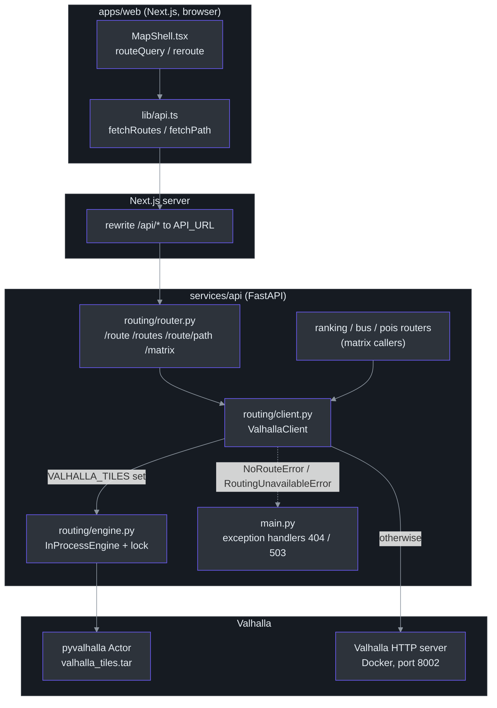
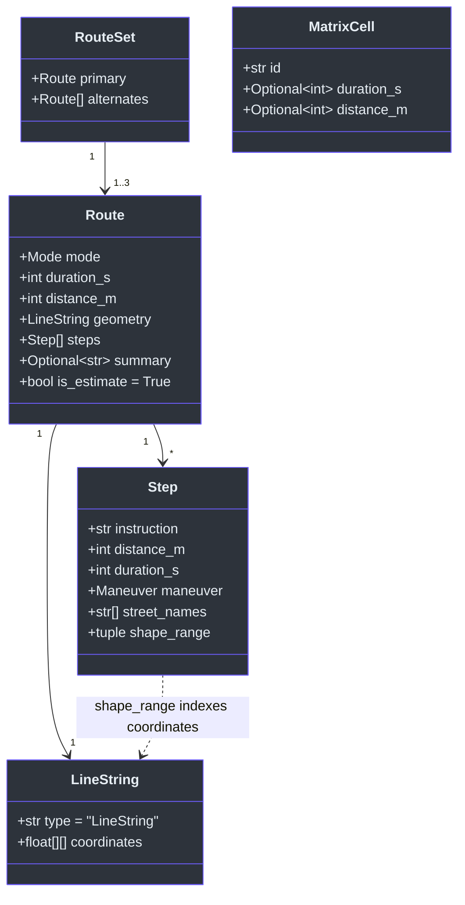
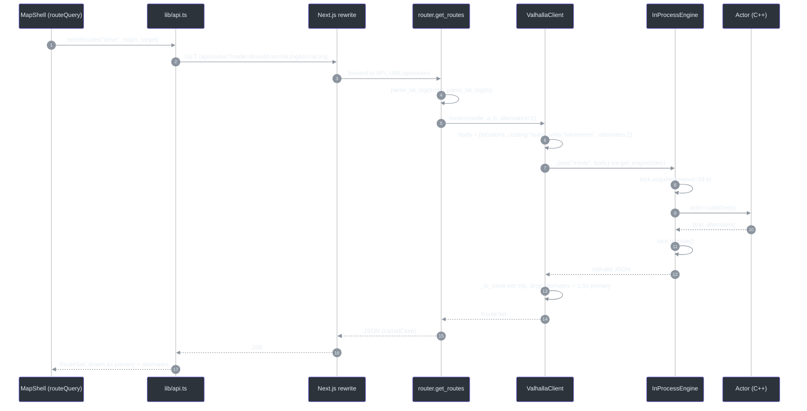
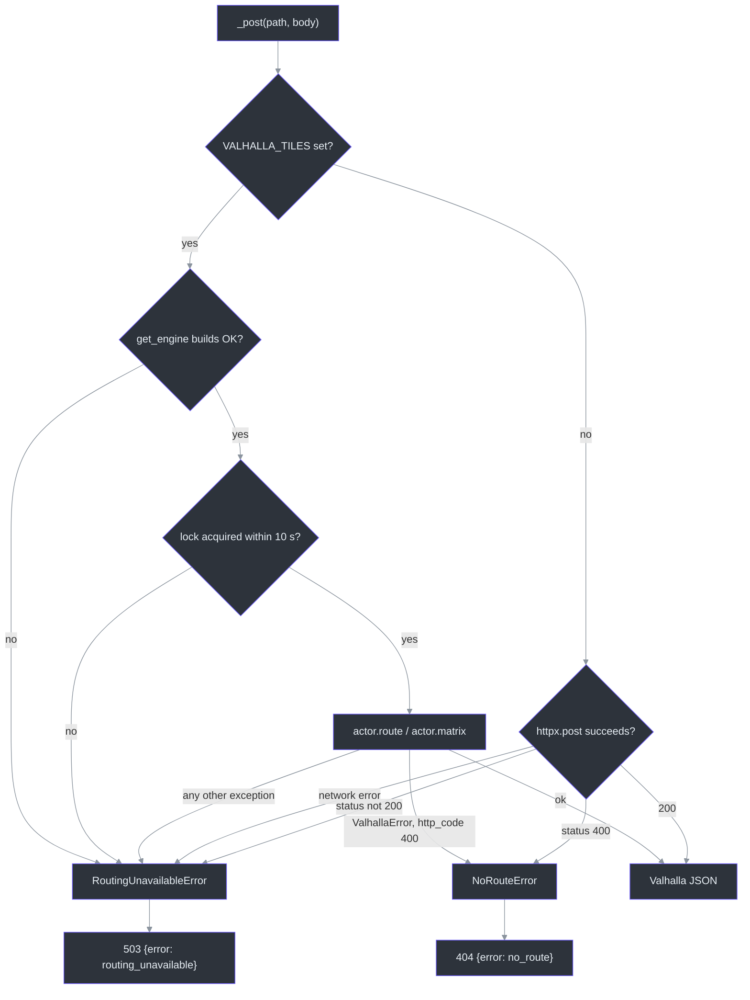
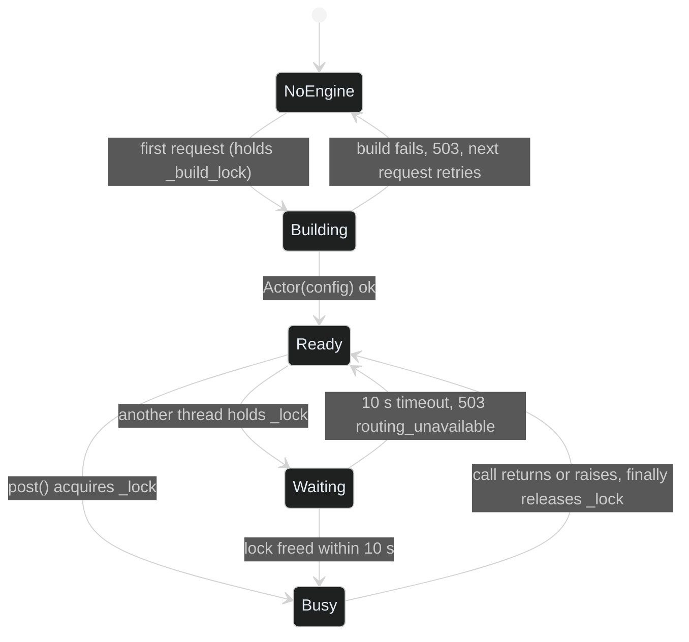

# Routing and ETA

## Overview: why this module exists

The app answers "how do I get from here to that ski resort, and how long will it take?" for driving and walking, in the style of Google Maps directions. Three needs shape the design:

| Need | Design answer | Source |
|------|---------------|--------|
| Real road routes and times, at **$0** | Self-hosted **Valhalla** (an open-source routing engine) over OpenStreetMap tiles for the Hakuba valley, instead of a paid routing API | [SPEC-routing.md:6](https://github.com/r03922123/jp_ski_map/blob/main/SPEC-routing.md#L6) |
| Run on a host with no Valhalla server (Vercel) and on the Mac standby (which has one) | One client, two backends: an **in-process Actor** when `VALHALLA_TILES` is set, else HTTP to `VALHALLA_URL` | [services/api/src/hakuba_api/routing/router.py:16-20](https://github.com/r03922123/jp_ski_map/blob/main/services/api/src/hakuba_api/routing/router.py#L16-L20) |
| Rank resorts, bus stops and restaurants by travel time | A **one-to-many matrix** call: one origin, up to 25 targets, durations only | [services/api/src/hakuba_api/routing/client.py:129-150](https://github.com/r03922123/jp_ski_map/blob/main/services/api/src/hakuba_api/routing/client.py#L129-L150) |

**ETA** here means *estimated time of arrival*, reported as a duration in seconds (`durationS`). It is not a learned model: Valhalla sums edge costs computed from typical road speeds. There is no live traffic and no winter-road adjustment; every route carries `isEstimate: true` so the UI can label it "ETA ~" ([models.py:30](https://github.com/r03922123/jp_ski_map/blob/main/services/api/src/hakuba_api/routing/models.py#L30), [SPEC-routing.md:37](https://github.com/r03922123/jp_ski_map/blob/main/SPEC-routing.md#L37)).

Terms used below:

- **Costing**: Valhalla's name for the cost model that turns a road edge into a time. `drive` maps to `auto`, `walk` to `pedestrian` ([client.py:10](https://github.com/r03922123/jp_ski_map/blob/main/services/api/src/hakuba_api/routing/client.py#L10)).
- **Actor**: the Python binding object (`pyvalhalla`) that runs Valhalla's C++ code inside the API process ([engine.py:15-18](https://github.com/r03922123/jp_ski_map/blob/main/services/api/src/hakuba_api/routing/engine.py#L15-L18)).
- **Encoded polyline**: a compact text encoding of a line of coordinates. Valhalla returns one per leg; the API decodes it to GeoJSON ([polyline.py:1-5](https://github.com/r03922123/jp_ski_map/blob/main/services/api/src/hakuba_api/routing/polyline.py#L1-L5)).

## Architecture


<!-- Sources: apps/web/src/components/MapShell.tsx:449, apps/web/src/lib/api.ts:69, apps/web/next.config.ts:46, services/api/src/hakuba_api/routing/router.py:16, services/api/src/hakuba_api/routing/client.py:80, services/api/src/hakuba_api/routing/engine.py:49, services/api/src/hakuba_api/main.py:114 -->

The seam that matters is `ValhallaClient._post`: everything above it speaks Valhalla's JSON request format, and only `_post` decides whether that JSON goes to a C++ object in memory or over the network ([client.py:80-94](https://github.com/r03922123/jp_ski_map/blob/main/services/api/src/hakuba_api/routing/client.py#L80-L94)). Both backends raise the same two exceptions, so the rest of the API never knows which one ran.

| Backend | When it runs | Strengths | Limits | Source |
|---------|--------------|-----------|--------|--------|
| In-process Actor | `VALHALLA_TILES` env var is set (Vercel) | No separate server to host; tiles ship inside the function bundle | One call at a time per process; a call cannot be interrupted | [engine.py:21-42](https://github.com/r03922123/jp_ski_map/blob/main/services/api/src/hakuba_api/routing/engine.py#L21-L42) |
| HTTP server | `VALHALLA_TILES` unset (Mac standby, local dev) | Valhalla runs in its own process with its own concurrency | Needs the Docker service up; 10 s request timeout | [client.py:75-94](https://github.com/r03922123/jp_ski_map/blob/main/services/api/src/hakuba_api/routing/client.py#L75-L94) |

`get_valhalla()` builds a fresh `ValhallaClient` on every request (FastAPI dependency), defaulting `VALHALLA_URL` to `http://localhost:8002` ([router.py:16-20](https://github.com/r03922123/jp_ski_map/blob/main/services/api/src/hakuba_api/routing/router.py#L16-L20)). The client itself is cheap; the expensive Actor is a process-wide singleton (see [Implementation](#in-process-engine-one-actor-one-lock)).

## Components

| Component | Role | Key identifiers | Source |
|-----------|------|-----------------|--------|
| Web API client | Builds query strings, turns non-2xx bodies into `ApiError(code, status)` | `fetchRoute`, `fetchRoutes`, `fetchPath`, `ApiError` | [apps/web/src/lib/api.ts:28-94](https://github.com/r03922123/jp_ski_map/blob/main/apps/web/src/lib/api.ts#L28-L94) |
| Map shell | Decides which endpoint to call and caches the result with TanStack Query | `routeQuery`, `useReroute({fetchRoute})` | [apps/web/src/components/MapShell.tsx:449-465](https://github.com/r03922123/jp_ski_map/blob/main/apps/web/src/components/MapShell.tsx#L449-L465) |
| Next.js rewrite | Forwards `/api/*` to the Python API (`API_URL`, default `127.0.0.1:8010`) | `rewrites()` | [apps/web/next.config.ts:4](https://github.com/r03922123/jp_ski_map/blob/main/apps/web/next.config.ts#L4), [:45-46](https://github.com/r03922123/jp_ski_map/blob/main/apps/web/next.config.ts#L45-L46) |
| FastAPI router | Validates input, injects the client, declares response models | `get_route`, `get_routes`, `post_route_path`, `post_matrix` | [routing/router.py:23-80](https://github.com/r03922123/jp_ski_map/blob/main/services/api/src/hakuba_api/routing/router.py#L23-L80) |
| Coordinate parser | `lat,lng` string to `Coord`; 422 on bad format or range | `parse_lat_lng` | [common/params.py:32-43](https://github.com/r03922123/jp_ski_map/blob/main/services/api/src/hakuba_api/common/params.py#L32-L43) |
| Valhalla client | Builds Valhalla requests, picks a backend, maps the response to `Route` | `ValhallaClient`, `_to_route`, `COSTING`, `MAX_ALTERNATE_RATIO` | [routing/client.py:10-150](https://github.com/r03922123/jp_ski_map/blob/main/services/api/src/hakuba_api/routing/client.py#L10-L150) |
| In-process engine | Owns the one Actor, serialises calls with a lock, maps binding errors | `InProcessEngine`, `get_engine`, `LOCK_WAIT_S` | [routing/engine.py:12-63](https://github.com/r03922123/jp_ski_map/blob/main/services/api/src/hakuba_api/routing/engine.py#L12-L63) |
| Maneuvers | Valhalla maneuver type (int) to a stable icon name; "via …" summary | `maneuver_for`, `route_summary` | [routing/maneuvers.py:12-46](https://github.com/r03922123/jp_ski_map/blob/main/services/api/src/hakuba_api/routing/maneuvers.py#L12-L46) |
| Polyline decoder | Precision-6 polyline to `(lng, lat)` pairs | `decode_polyline` | [routing/polyline.py:1-24](https://github.com/r03922123/jp_ski_map/blob/main/services/api/src/hakuba_api/routing/polyline.py#L1-L24) |
| Models | Wire shapes, camelCase on the wire via `ApiModel` | `Route`, `RouteSet`, `Step`, `MatrixCell`, `LineString` | [routing/models.py:6-41](https://github.com/r03922123/jp_ski_map/blob/main/services/api/src/hakuba_api/routing/models.py#L6-L41), [common/models.py:5-8](https://github.com/r03922123/jp_ski_map/blob/main/services/api/src/hakuba_api/common/models.py#L5-L8) |
| Error handlers | `NoRouteError` → 404 `no_route`; `RoutingUnavailableError` → 503 `routing_unavailable` | `no_route`, `routing_unavailable` | [main.py:114-121](https://github.com/r03922123/jp_ski_map/blob/main/services/api/src/hakuba_api/main.py#L114-L121) |

### Endpoints

| Endpoint | Input | Output | Valhalla call | Source |
|----------|-------|--------|---------------|--------|
| `GET /api/route` | `mode`, `from=lat,lng`, `to=lat,lng` | `Route` | `/route`, no alternates | [router.py:23-30](https://github.com/r03922123/jp_ski_map/blob/main/services/api/src/hakuba_api/routing/router.py#L23-L30) |
| `GET /api/routes` | same, plus `alternates` 0..2 (default 2) | `RouteSet` | `/route` with `alternates: n` | [router.py:33-44](https://github.com/r03922123/jp_ski_map/blob/main/services/api/src/hakuba_api/routing/router.py#L33-L44) |
| `POST /api/route/path` | `mode`, 2..25 `points`, `stopAtPoints` | `Route` | `/route`, middle points `through` unless stops | [router.py:47-60](https://github.com/r03922123/jp_ski_map/blob/main/services/api/src/hakuba_api/routing/router.py#L47-L60) |
| `POST /api/matrix` | `mode`, `origin`, ≤25 `targets` | `MatrixCell[]` | `/sources_to_targets` | [router.py:63-80](https://github.com/r03922123/jp_ski_map/blob/main/services/api/src/hakuba_api/routing/router.py#L63-L80) |

### Data model


<!-- Sources: services/api/src/hakuba_api/routing/models.py:9-41, services/api/src/hakuba_api/common/models.py:5-8 -->

Python fields are snake_case; `ApiModel` uses `alias_generator=to_camel`, so the JSON says `durationS`, `shapeRange`, `isEstimate` ([common/models.py:8](https://github.com/r03922123/jp_ski_map/blob/main/services/api/src/hakuba_api/common/models.py#L8)). `MatrixCell.duration_s` is `None` when Valhalla cannot reach that target ([models.py:40](https://github.com/r03922123/jp_ski_map/blob/main/services/api/src/hakuba_api/routing/models.py#L40)). The web app uses generated TypeScript types for the same shapes (`components["schemas"]["Route"]`, [api.ts:5-8](https://github.com/r03922123/jp_ski_map/blob/main/apps/web/src/lib/api.ts#L5-L8)).

## Data flow: one real request, step by step

Example: the user picks a resort on the Drive tab with no extra stops. `MapShell` calls `fetchRoutes` because `viaStops` is empty ([MapShell.tsx:461](https://github.com/r03922123/jp_ski_map/blob/main/apps/web/src/components/MapShell.tsx#L461)).


<!-- Sources: apps/web/src/components/MapShell.tsx:449-465, apps/web/src/lib/api.ts:69-72, apps/web/next.config.ts:46, services/api/src/hakuba_api/routing/router.py:33-44, services/api/src/hakuba_api/common/params.py:32, services/api/src/hakuba_api/routing/client.py:99-115, services/api/src/hakuba_api/routing/engine.py:32-42 -->

| Step | What happens | Why | Source |
|------|--------------|-----|--------|
| 1 | Query key is `["routes", routeMode, origin, target, viaStops]`; runs only when both ends exist; `retry: false` | The cache refetches only when an input changes; a failed route should show an error, not retry silently | [MapShell.tsx:449-465](https://github.com/r03922123/jp_ski_map/blob/main/apps/web/src/components/MapShell.tsx#L449-L465) |
| 2 | `latLng()` formats `lat,lng` into the query string | The API's documented contract | [api.ts:49](https://github.com/r03922123/jp_ski_map/blob/main/apps/web/src/lib/api.ts#L49), [:69-72](https://github.com/r03922123/jp_ski_map/blob/main/apps/web/src/lib/api.ts#L69-L72) |
| 3 | Next rewrites `/api/:path*` to the API server | Browser talks to one origin; no CORS setup | [next.config.ts:45-46](https://github.com/r03922123/jp_ski_map/blob/main/apps/web/next.config.ts#L45-L46) |
| 4 | `parse_lat_lng` rejects bad format or out-of-range values with 422 | Validate at the trust boundary before any engine work | [params.py:32-43](https://github.com/r03922123/jp_ski_map/blob/main/services/api/src/hakuba_api/common/params.py#L32-L43) |
| 5–6 | `{lat, lng}` becomes Valhalla's `{lat, lon}`; costing from `COSTING` | Coordinate order is converted only inside `routing` | [client.py:22-23](https://github.com/r03922123/jp_ski_map/blob/main/services/api/src/hakuba_api/routing/client.py#L22-L23), [:99-106](https://github.com/r03922123/jp_ski_map/blob/main/services/api/src/hakuba_api/routing/client.py#L99-L106) |
| 7–11 | Backend call (here in process, under the lock) | See next section | [engine.py:32-42](https://github.com/r03922123/jp_ski_map/blob/main/services/api/src/hakuba_api/routing/engine.py#L32-L42) |
| 13 | Each trip → `Route`; alternates slower than 1.5× the primary are dropped, then capped at the requested count | "Detours nobody would pick" | [client.py:11](https://github.com/r03922123/jp_ski_map/blob/main/services/api/src/hakuba_api/routing/client.py#L11), [:108-115](https://github.com/r03922123/jp_ski_map/blob/main/services/api/src/hakuba_api/routing/client.py#L108-L115) |
| 17 | On non-2xx, `ApiError(body.error ?? "http_<status>", status)` | The UI can show "no route" vs "routing unavailable" | [api.ts:37-47](https://github.com/r03922123/jp_ski_map/blob/main/apps/web/src/lib/api.ts#L37-L47) |

Other entry points use the same client:

| Caller | Call | Purpose | Source |
|--------|------|---------|--------|
| Trip with stops (Drive/Walk) | `fetchPath(mode, [origin, ...viaStops, target], {stopAtPoints: true})` | One route with real stops; no alternates | [MapShell.tsx:455-460](https://github.com/r03922123/jp_ski_map/blob/main/apps/web/src/components/MapShell.tsx#L455-L460) |
| Live navigation reroute | `fetchPath` or `fetchRoutes(...).primary` from the current GPS fix | Off-route reroute | [MapShell.tsx:524-536](https://github.com/r03922123/jp_ski_map/blob/main/apps/web/src/components/MapShell.tsx#L524-L536) |
| Bus ride leg | `fetchPath("drive", rideStops)` (pass-through stops) | Draw the bus's road path | [MapShell.tsx:393](https://github.com/r03922123/jp_ski_map/blob/main/apps/web/src/components/MapShell.tsx#L393) |
| Resort ranking | `valhalla.matrix("drive", origin, every access point)` | Drive time per resort | [ranking/router.py:53](https://github.com/r03922123/jp_ski_map/blob/main/services/api/src/hakuba_api/ranking/router.py#L53) |
| Bus stops near a place | `valhalla.matrix("walk", place, located stops)` | Walk seconds to stops | [bus/router.py:87](https://github.com/r03922123/jp_ski_map/blob/main/services/api/src/hakuba_api/bus/router.py#L87) |
| Nearby restaurants / konbini | 25 nearest by straight line, then one matrix call | Rank by travel time | [pois/query.py:10](https://github.com/r03922123/jp_ski_map/blob/main/services/api/src/hakuba_api/pois/query.py#L10), [:33](https://github.com/r03922123/jp_ski_map/blob/main/services/api/src/hakuba_api/pois/query.py#L33) |

The internal matrix callers (ranking, bus) call `ValhallaClient.matrix` directly, so the 25-target cap on `MatrixRequest` does not apply to them ([router.py:72](https://github.com/r03922123/jp_ski_map/blob/main/services/api/src/hakuba_api/routing/router.py#L72) caps only the HTTP body). Today the ranking sends 12 targets (the access points of 10 resorts in `data/resorts.json`, [ranking/router.py:52-53](https://github.com/r03922123/jp_ski_map/blob/main/services/api/src/hakuba_api/ranking/router.py#L52-L53)), and every bus request sends 98 (all stops with coordinates in `data/bus_stops.json`, [bus/router.py:86-87](https://github.com/r03922123/jp_ski_map/blob/main/services/api/src/hakuba_api/bus/router.py#L86-L87)). So each bus request holds the engine lock for a 98-target walk matrix.

### Error flow


<!-- Sources: services/api/src/hakuba_api/routing/client.py:80-94, services/api/src/hakuba_api/routing/engine.py:32-63, services/api/src/hakuba_api/main.py:114-121 -->

## Implementation

### In-process engine: one Actor, one lock

**Why a lock.** FastAPI runs plain `def` endpoints on a thread pool, so two requests can hit the API at once. The `pyvalhalla` binding releases Python's GIL (global interpreter lock) during a call, and a shared Actor crashes the process under concurrent calls. So every call takes one `threading.Lock` ([engine.py:22](https://github.com/r03922123/jp_ski_map/blob/main/services/api/src/hakuba_api/routing/engine.py#L22), [:30-42](https://github.com/r03922123/jp_ski_map/blob/main/services/api/src/hakuba_api/routing/engine.py#L30-L42); rationale in [SPEC-deploy.md:125-130](https://github.com/r03922123/jp_ski_map/blob/main/SPEC-deploy.md#L125-L130)).

**Why a bounded wait.** The C++ call cannot be interrupted, so a request waits at most `LOCK_WAIT_S = 10.0` s for the lock and then raises `RoutingUnavailableError("routing busy")`, which the client sees as a 503 `{"error": "routing_unavailable"}` instead of a hang ([engine.py:12](https://github.com/r03922123/jp_ski_map/blob/main/services/api/src/hakuba_api/routing/engine.py#L12), [:33-34](https://github.com/r03922123/jp_ski_map/blob/main/services/api/src/hakuba_api/routing/engine.py#L33-L34)). That is also why `/api/matrix` and `/api/route/path` cap their inputs at 25: one big request would hold the lock for everyone (this guards only the HTTP endpoints; the internal bus matrix above is larger) ([router.py:49](https://github.com/r03922123/jp_ski_map/blob/main/services/api/src/hakuba_api/routing/router.py#L49), [:72](https://github.com/r03922123/jp_ski_map/blob/main/services/api/src/hakuba_api/routing/router.py#L72)).

**Why a hand-written singleton.** `get_engine` builds the Actor once per process under a separate `_build_lock`. It avoids `functools.cache` because racing threads may each run the cached function, which would build two Actors. A failed build is not stored, so the next request retries ([engine.py:45-63](https://github.com/r03922123/jp_ski_map/blob/main/services/api/src/hakuba_api/routing/engine.py#L45-L63)). The binding is imported lazily so the HTTP backend never needs it ([engine.py:56-57](https://github.com/r03922123/jp_ski_map/blob/main/services/api/src/hakuba_api/routing/engine.py#L56-L57)); the config is the tile tar only ([engine.py:58](https://github.com/r03922123/jp_ski_map/blob/main/services/api/src/hakuba_api/routing/engine.py#L58)).


<!-- Sources: services/api/src/hakuba_api/routing/engine.py:12, services/api/src/hakuba_api/routing/engine.py:32-42, services/api/src/hakuba_api/routing/engine.py:45-63 -->

The tests check these properties with a fake binding, for example `test_eight_threads_never_run_the_actor_at_the_same_time`, `test_concurrent_first_calls_build_one_engine` and `test_a_failed_build_is_routing_unavailable_and_is_retried` ([tests/routing/test_inprocess.py:139](https://github.com/r03922123/jp_ski_map/blob/main/services/api/tests/routing/test_inprocess.py#L139), [:228](https://github.com/r03922123/jp_ski_map/blob/main/services/api/tests/routing/test_inprocess.py#L228), [:241](https://github.com/r03922123/jp_ski_map/blob/main/services/api/tests/routing/test_inprocess.py#L241)).

Path mapping is a dict: `"/route"` → `actor.route`, `"/sources_to_targets"` → `actor.matrix` ([engine.py:27](https://github.com/r03922123/jp_ski_map/blob/main/services/api/src/hakuba_api/routing/engine.py#L27)). The same paths are used as URLs in HTTP mode, which is what keeps the two backends interchangeable.

### From Valhalla trip to `Route`

`_to_route` flattens a multi-leg Valhalla trip into one line and one step list ([client.py:30-71](https://github.com/r03922123/jp_ski_map/blob/main/services/api/src/hakuba_api/routing/client.py#L30-L71)). Pseudocode:

```python
coords, steps = [], []
for leg in trip["legs"]:
    offset = max(len(coords) - 1, 0)          # legs share their joining point
    shape = decode_polyline(leg["shape"])     # precision 6, already (lng, lat)
    coords += shape[1:] if coords else shape  # don't duplicate the join
    for m in leg["maneuvers"]:
        if m is an intermediate "arrive" (type 4/5/6, not last leg):
            skip it for pass-through points, or rename to "Arrive at stop N" for real stops
        steps.append(Step(km*1000 -> metres, time -> seconds,
                          maneuver_for(type), shape_range = indices + offset))
route.duration_s = round(trip["summary"]["time"])   # this is the ETA
route.summary = "via <top 1-2 roads by distance>"
```

| Detail | Behaviour | Source |
|--------|-----------|--------|
| ETA | `trip.summary.time`, rounded to whole seconds; per-step `time` likewise | [client.py:55](https://github.com/r03922123/jp_ski_map/blob/main/services/api/src/hakuba_api/routing/client.py#L55), [:66](https://github.com/r03922123/jp_ski_map/blob/main/services/api/src/hakuba_api/routing/client.py#L66) |
| Units | Request `units: "kilometers"`, convert km → m | [client.py:103](https://github.com/r03922123/jp_ski_map/blob/main/services/api/src/hakuba_api/routing/client.py#L103), [:67](https://github.com/r03922123/jp_ski_map/blob/main/services/api/src/hakuba_api/routing/client.py#L67) |
| `shapeRange` | Valhalla `begin/end_shape_index` plus the leg offset, so step ranges tile the joined geometry | [client.py:58-61](https://github.com/r03922123/jp_ski_map/blob/main/services/api/src/hakuba_api/routing/client.py#L58-L61) |
| Pass-through points | Middle locations get `type: "through"` unless `stop_at_points` | [client.py:117-127](https://github.com/r03922123/jp_ski_map/blob/main/services/api/src/hakuba_api/routing/client.py#L117-L127) |
| Maneuver icon | Integer type → 17-word vocabulary; unknown → `straight` | [maneuvers.py:12-27](https://github.com/r03922123/jp_ski_map/blob/main/services/api/src/hakuba_api/routing/maneuvers.py#L12-L27) |
| "via …" summary | Sum length per road label (name, else `Route <number>`), keep top two | [maneuvers.py:30-46](https://github.com/r03922123/jp_ski_map/blob/main/services/api/src/hakuba_api/routing/maneuvers.py#L30-L46) |
| Polyline | Zig-zag varint decoding, lat then lng deltas, output `(lng, lat)` | [polyline.py:9-24](https://github.com/r03922123/jp_ski_map/blob/main/services/api/src/hakuba_api/routing/polyline.py#L9-L24) |

### Matrix

`matrix()` sends one source and N targets to `/sources_to_targets`, sorts the single result row by `to_index`, and zips it with the target ids using `strict=True`, so a length mismatch raises instead of mislabelling times ([client.py:129-150](https://github.com/r03922123/jp_ski_map/blob/main/services/api/src/hakuba_api/routing/client.py#L129-L150)). Unreachable targets keep `durationS: null` rather than failing the whole call ([client.py:146-147](https://github.com/r03922123/jp_ski_map/blob/main/services/api/src/hakuba_api/routing/client.py#L146-L147)); the ranking router then picks each resort's nearest reachable access point ([ranking/router.py:56-59](https://github.com/r03922123/jp_ski_map/blob/main/services/api/src/hakuba_api/ranking/router.py#L56-L59)).

### Where an ML model could plug in

There is no learned component in routing today; the ETA is Valhalla's cost-model sum. The code shows two natural seams. Both are **inference**, not existing features:

| Seam | What a model would do | Existing hook | Source |
|------|----------------------|---------------|--------|
| Post-process `Route.duration_s` | Correct Valhalla's typical-speed ETA (for example for snow), keeping `is_estimate=True` | `_to_route` sets `duration_s` in one place | [client.py:64-71](https://github.com/r03922123/jp_ski_map/blob/main/services/api/src/hakuba_api/routing/client.py#L64-L71) |
| Edge speeds at tile build time | Replace or tune `default_speeds.json` used when tiles are built | Tile build script | [SPEC-deploy.md:344-347](https://github.com/r03922123/jp_ski_map/blob/main/SPEC-deploy.md#L344-L347) |

The spec records the decision to show the raw Valhalla ETA with no winter multiplier ([SPEC-routing.md:37](https://github.com/r03922123/jp_ski_map/blob/main/SPEC-routing.md#L37)), and switching to a hosted routing API or adding traffic data needs the owner's OK ([SPEC-routing.md:33](https://github.com/r03922123/jp_ski_map/blob/main/SPEC-routing.md#L33)).

## References

| File | What to read it for |
|------|--------------------|
| [SPEC-routing.md](https://github.com/r03922123/jp_ski_map/blob/main/SPEC-routing.md) | Interface, acceptance criteria, v1.1 alternates/steps scope |
| [SPEC-deploy.md:118-130](https://github.com/r03922123/jp_ski_map/blob/main/SPEC-deploy.md#L118-L130) | Why the in-process backend, the lock and the 25-target bound exist |
| [services/api/src/hakuba_api/routing/router.py](https://github.com/r03922123/jp_ski_map/blob/main/services/api/src/hakuba_api/routing/router.py) | HTTP endpoints and backend selection |
| [services/api/src/hakuba_api/routing/client.py](https://github.com/r03922123/jp_ski_map/blob/main/services/api/src/hakuba_api/routing/client.py) | Request building and response mapping |
| [services/api/src/hakuba_api/routing/engine.py](https://github.com/r03922123/jp_ski_map/blob/main/services/api/src/hakuba_api/routing/engine.py) | In-process Actor and locking |
| [services/api/src/hakuba_api/routing/maneuvers.py](https://github.com/r03922123/jp_ski_map/blob/main/services/api/src/hakuba_api/routing/maneuvers.py) | Maneuver icons and "via" summary |
| [services/api/src/hakuba_api/routing/polyline.py](https://github.com/r03922123/jp_ski_map/blob/main/services/api/src/hakuba_api/routing/polyline.py) | Polyline decoding |
| [services/api/src/hakuba_api/routing/models.py](https://github.com/r03922123/jp_ski_map/blob/main/services/api/src/hakuba_api/routing/models.py) | Wire models |
| [services/api/src/hakuba_api/main.py:114-121](https://github.com/r03922123/jp_ski_map/blob/main/services/api/src/hakuba_api/main.py#L114-L121) | Error-to-status mapping |
| [apps/web/src/lib/api.ts](https://github.com/r03922123/jp_ski_map/blob/main/apps/web/src/lib/api.ts) | Browser-side fetch helpers |
| [apps/web/src/components/MapShell.tsx](https://github.com/r03922123/jp_ski_map/blob/main/apps/web/src/components/MapShell.tsx) | Which route call the UI makes and when |
| [services/api/tests/routing/](https://github.com/r03922123/jp_ski_map/tree/main/services/api/tests/routing) | `test_inprocess.py`, `test_routing.py`, `test_steps.py`, `test_alternates.py`, `test_coverage.py` |

## Related Pages

| Page | Relationship |
|------|-------------|
| [Bus schedules](../02-bus/bus-schedules.md) | Uses the walk matrix to find nearby stops and `/api/route/path` to draw the ride leg |
| [Semantic place search](../03-search/semantic-place-search.md) | Produces the origin and destination coordinates that routing consumes |
| [Crowd level](../04-crowd/crowd-level.md) | Combined with matrix drive times in the resort ranking |
