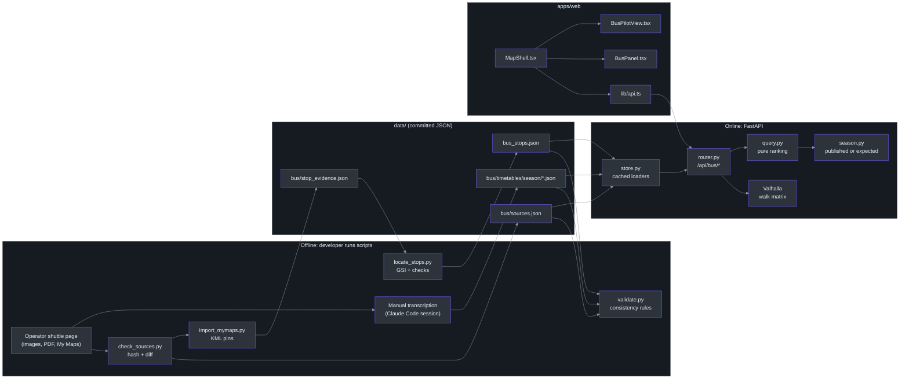
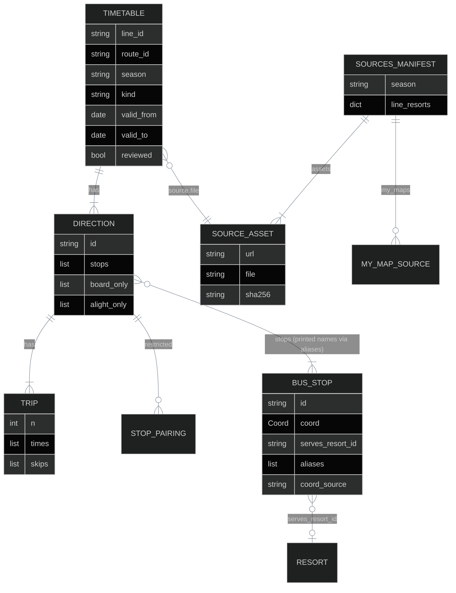
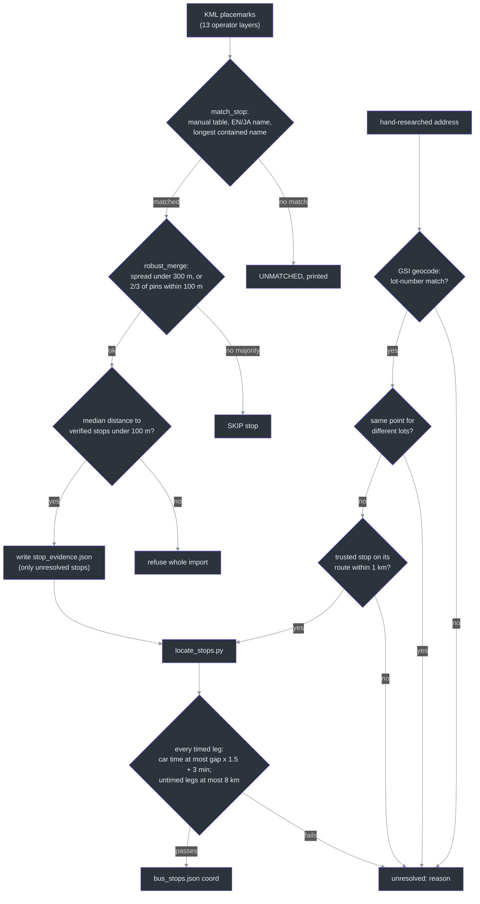
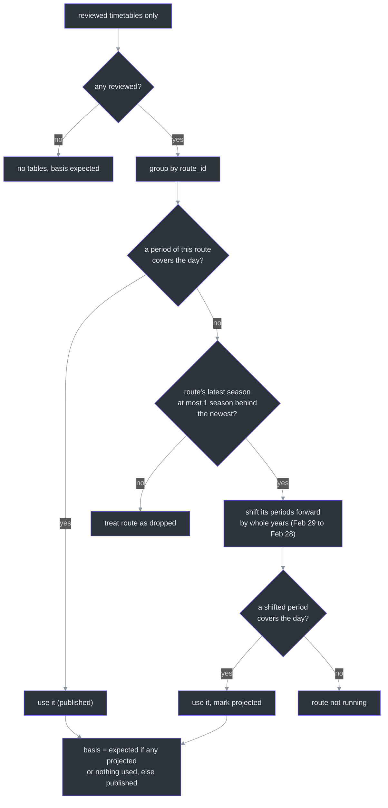
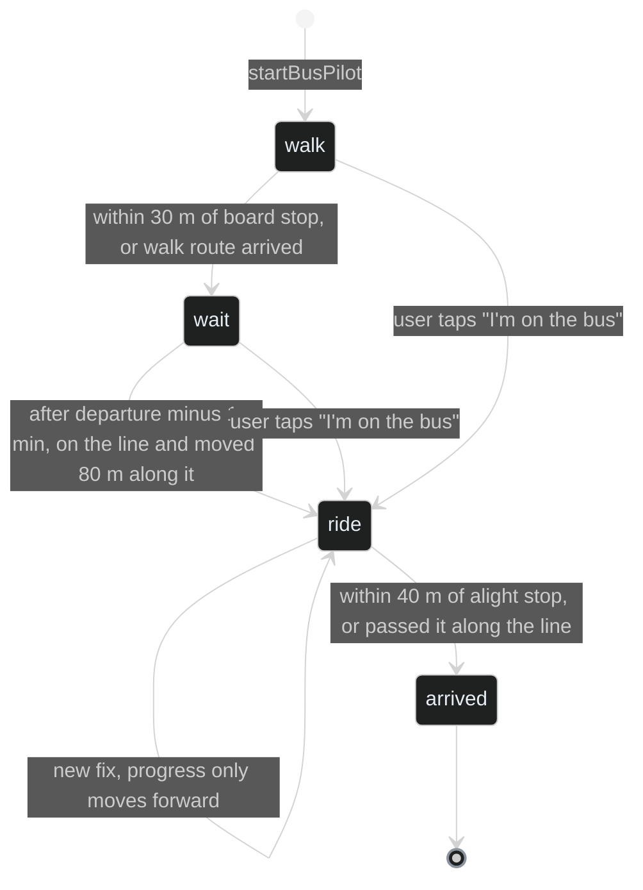

# Bus Schedules

The `bus-schedules` module answers one question for a skier: **"From where I am, which shuttle bus do I take, when does it leave, and when do I reach the resort (or get back to my hotel)?"**

This page follows the data from the operator's web page, through the import scripts and JSON files, into the API, and out to the phone screen.

## Overview: why this module exists

Hakuba Valley runs about 14 shuttle lines between hotels and ski resorts. The operator publishes timetables as **images and a PDF poster**. There is no machine-readable feed like GTFS (General Transit Feed Specification, the standard format Google Maps uses for transit). So the project has to build its own feed. The constraints shape every design choice:

| Constraint | Consequence in the code | Source |
|---|---|---|
| Cost must stay $0: no paid OCR, no Claude API calls from code | Timetables are typed in by hand during a Claude Code session, then validated by code | [SPEC-bus-schedules.md:78](https://github.com/r03922123/jp_ski_map/blob/main/SPEC-bus-schedules.md#L78) |
| A wrong time strands a skier in the snow | Nothing is served unless `reviewed: true`, and a validator catches typos | [services/api/src/hakuba_api/bus/models.py:71](https://github.com/r03922123/jp_ski_map/blob/main/services/api/src/hakuba_api/bus/models.py#L71) |
| The operator changes images without notice | A watcher hashes every asset (sha256) and fails when one changes | [services/api/src/hakuba_api/bus/check_sources.py:111-118](https://github.com/r03922123/jp_ski_map/blob/main/services/api/src/hakuba_api/bus/check_sources.py#L111-L118) |
| Stops have names but no coordinates | Two scripts locate stops and reject any point the timetable contradicts | [services/api/src/hakuba_api/bus/locate_stops.py:1-10](https://github.com/r03922123/jp_ski_map/blob/main/services/api/src/hakuba_api/bus/locate_stops.py#L1-L10) |
| Off-season, last year's data is all there is | Last season is shifted forward by whole years and labelled **Expected** | [services/api/src/hakuba_api/bus/season.py:1-9](https://github.com/r03922123/jp_ski_map/blob/main/services/api/src/hakuba_api/bus/season.py#L1-L9) |

An ML analogy that holds up: the import side is a **labelling pipeline** (human annotation + automatic consistency checks), and the query side is **pure inference** over a frozen dataset. The query functions do no I/O at all ([services/api/src/hakuba_api/bus/query.py:1](https://github.com/r03922123/jp_ski_map/blob/main/services/api/src/hakuba_api/bus/query.py#L1)), which is why they are easy to unit-test.

## Architecture

The module has two halves that never run at the same time:

- **Offline (a developer runs it):** detect source changes, transcribe, locate stops, validate, commit JSON to git.
- **Online (every user request):** FastAPI loads the committed JSON once, asks Valhalla (the open-source routing engine) for walking times, and runs pure query functions.


<!-- Sources: services/api/src/hakuba_api/bus/check_sources.py:132-203, services/api/src/hakuba_api/bus/import_mymaps.py:137-207, services/api/src/hakuba_api/bus/locate_stops.py:160-241, services/api/src/hakuba_api/bus/store.py:11-34, services/api/src/hakuba_api/bus/router.py:133-172, apps/web/src/components/MapShell.tsx:335-366 -->

The router is mounted on the main app at [services/api/src/hakuba_api/main.py:80](https://github.com/r03922123/jp_ski_map/blob/main/services/api/src/hakuba_api/main.py#L80), and the repo-wide data check (`python -m hakuba_api.data.validate`) calls the bus validator at [services/api/src/hakuba_api/data/validate.py:22](https://github.com/r03922123/jp_ski_map/blob/main/services/api/src/hakuba_api/data/validate.py#L22).

## Components

### At a glance

| File | Role | Runs when | Source |
|---|---|---|---|
| `check_sources.py` | Fetch operator page, download assets and My Maps KML, sha256 diff against `sources.json` | Manually, and by the `timetable-watch.yml` cron | [check_sources.py:132](https://github.com/r03922123/jp_ski_map/blob/main/services/api/src/hakuba_api/bus/check_sources.py#L132) |
| `import_mymaps.py` | Parse operator KML pins, match to stops, merge by median, write evidence | After `check_sources` reports changed stop maps | [import_mymaps.py:137](https://github.com/r03922123/jp_ski_map/blob/main/services/api/src/hakuba_api/bus/import_mymaps.py#L137) |
| `locate_stops.py` | Geocode addresses with GSI, reject points the timetable contradicts, write `bus_stops.json` | After evidence changes | [locate_stops.py:160](https://github.com/r03922123/jp_ski_map/blob/main/services/api/src/hakuba_api/bus/locate_stops.py#L160) |
| `validate.py` | Catch transcription mistakes | `python -m hakuba_api.data.validate` | [validate.py:99](https://github.com/r03922123/jp_ski_map/blob/main/services/api/src/hakuba_api/bus/validate.py#L99) |
| `models.py` | Pydantic shapes of stops and timetables | Import time | [models.py:60](https://github.com/r03922123/jp_ski_map/blob/main/services/api/src/hakuba_api/bus/models.py#L60) |
| `store.py` | Read JSON once per process (`@cache`) | First request | [store.py:11-19](https://github.com/r03922123/jp_ski_map/blob/main/services/api/src/hakuba_api/bus/store.py#L11-L19) |
| `season.py` | Pick the timetables that apply on a day; project last season | Every query | [season.py:74](https://github.com/r03922123/jp_ski_map/blob/main/services/api/src/hakuba_api/bus/season.py#L74) |
| `query.py` | Pure functions: options to resorts, to a place, night departures | Every query | [query.py:135](https://github.com/r03922123/jp_ski_map/blob/main/services/api/src/hakuba_api/bus/query.py#L135) |
| `router.py` | HTTP endpoints, walk times, hotel-name matching | Every query | [router.py:23](https://github.com/r03922123/jp_ski_map/blob/main/services/api/src/hakuba_api/bus/router.py#L23) |

### Data model (`models.py`)

The JSON on disk is camelCase; Python uses snake_case. `ApiModel` (in `common/models.py`) handles the conversion (inference from the `by_alias=True` dumps at [locate_stops.py:237](https://github.com/r03922123/jp_ski_map/blob/main/services/api/src/hakuba_api/bus/locate_stops.py#L237); not opened here).


<!-- Sources: services/api/src/hakuba_api/bus/models.py:15-73, services/api/src/hakuba_api/bus/check_sources.py:41-59 -->

| Field | Meaning, and why it exists | Source |
|---|---|---|
| `Trip.times` | One `"HH:MM"` per stop, or `null` = "doesn't stop" **or** "not published" (see below) | [models.py:36](https://github.com/r03922123/jp_ski_map/blob/main/services/api/src/hakuba_api/bus/models.py#L36) |
| `Trip.skips` | On a first-stop-only trip, stops printed as "—" (the bus really doesn't go there) | [models.py:37](https://github.com/r03922123/jp_ski_map/blob/main/services/api/src/hakuba_api/bus/models.py#L37) |
| `Direction.board_only` / `alight_only` / `restricted` | Indexes, not names, because a loop line lists a stop twice | [models.py:49-52](https://github.com/r03922123/jp_ski_map/blob/main/services/api/src/hakuba_api/bus/models.py#L49-L52) |
| `Timetable.season` | `YYYY-YY`, validated as consecutive years so seasons sort as strings | [models.py:63](https://github.com/r03922123/jp_ski_map/blob/main/services/api/src/hakuba_api/bus/models.py#L63), [models.py:75-80](https://github.com/r03922123/jp_ski_map/blob/main/services/api/src/hakuba_api/bus/models.py#L75-L80) |
| `Timetable.kind` | `"day"` or `"night"`; night buses never appear in resort options | [models.py:64](https://github.com/r03922123/jp_ski_map/blob/main/services/api/src/hakuba_api/bus/models.py#L64) |
| `Timetable.reviewed` | A human compared it with the image; never served otherwise | [models.py:71](https://github.com/r03922123/jp_ski_map/blob/main/services/api/src/hakuba_api/bus/models.py#L71) |
| `BusStop.coord` | `None` = not located; such a stop can't be walked to | [models.py:18](https://github.com/r03922123/jp_ski_map/blob/main/services/api/src/hakuba_api/bus/models.py#L18) |
| `BusStop.aliases` | Exact English names as printed on timetables; the join key | [models.py:20](https://github.com/r03922123/jp_ski_map/blob/main/services/api/src/hakuba_api/bus/models.py#L20) |

**The two meanings of `null`.** On a trip with only one printed time (lines F, G, N's return), `null` means "the operator didn't publish this time". On every other trip it means "this bus doesn't stop here". The query tells them apart by counting printed times ([query.py:240-242](https://github.com/r03922123/jp_ski_map/blob/main/services/api/src/hakuba_api/bus/query.py#L240-L242)).

### Where the data files live

| Path | Content | In git? | Source |
|---|---|---|---|
| `data/bus/sources.json` | Season, page URL, line→resort map, sha256 of every asset and My Maps KML | Yes | [check_sources.py:54-59](https://github.com/r03922123/jp_ski_map/blob/main/services/api/src/hakuba_api/bus/check_sources.py#L54-L59) |
| `data/bus/timetables/<season>/<line>-<route>.json` | One `Timetable` per route and period (42 files for `2025-26` when this page was written) | Yes | [store.py:16-19](https://github.com/r03922123/jp_ski_map/blob/main/services/api/src/hakuba_api/bus/store.py#L16-L19) |
| `data/bus/stop_evidence.json` | Hand-researched address or point per stop, plus imported My Maps pins | Yes | [import_mymaps.py:182-205](https://github.com/r03922123/jp_ski_map/blob/main/services/api/src/hakuba_api/bus/import_mymaps.py#L182-L205) |
| `data/bus_stops.json` | All stops with `coord`, `servesResortId`, `aliases`, `coordSource` | Yes | [store.py:11-13](https://github.com/r03922123/jp_ski_map/blob/main/services/api/src/hakuba_api/bus/store.py#L11-L13) |
| `data/bus/raw/<season>/` | Downloaded images, PDFs and `mymaps/<mid>.kml` | No (`.gitignore` line 19; third-party files) | [check_sources.py:134-149](https://github.com/r03922123/jp_ski_map/blob/main/services/api/src/hakuba_api/bus/check_sources.py#L134-L149) |

The `data/` root is `HAKUBA_DATA_DIR` if set, else five levels above `paths.py` ([services/api/src/hakuba_api/data/paths.py:5-11](https://github.com/r03922123/jp_ski_map/blob/main/services/api/src/hakuba_api/data/paths.py#L5-L11)). Counted from the data files when this page was written: 100 stops, 98 with coordinates, 16 serving a resort; 42 timetables, all reviewed; 2 night routes (`vn`, `konayuki`). These numbers will drift; re-count rather than trust them.

## Data flow, part 1: importing the data

### Step 1: detect changes (`check_sources.py`)

**Why:** the operator replaces a timetable image without telling anyone. Hashing every file turns "did anything change?" into a cheap equality test.

1. Download the page at `PAGE_URL` ([check_sources.py:23](https://github.com/r03922123/jp_ski_map/blob/main/services/api/src/hakuba_api/bus/check_sources.py#L23)) and parse it ([check_sources.py:98-108](https://github.com/r03922123/jp_ski_map/blob/main/services/api/src/hakuba_api/bus/check_sources.py#L98-L108)):
   - asset links matching uploaded `.jpg/.png/.pdf` ([check_sources.py:24-26](https://github.com/r03922123/jp_ski_map/blob/main/services/api/src/hakuba_api/bus/check_sources.py#L24-L26));
   - the season, read from the poster PDF name such as `2025-2026-Shuttle-Bus-Timetable.pdf`, keeping the newest ([check_sources.py:28](https://github.com/r03922123/jp_ski_map/blob/main/services/api/src/hakuba_api/bus/check_sources.py#L28), [check_sources.py:104](https://github.com/r03922123/jp_ski_map/blob/main/services/api/src/hakuba_api/bus/check_sources.py#L104));
   - the line→resort list from the HTML ([check_sources.py:86-95](https://github.com/r03922123/jp_ski_map/blob/main/services/api/src/hakuba_api/bus/check_sources.py#L86-L95));
   - each embedded My Maps layer, paired with the timetable image just before it ([check_sources.py:76-83](https://github.com/r03922123/jp_ski_map/blob/main/services/api/src/hakuba_api/bus/check_sources.py#L76-L83)).
2. Download every asset and each layer's KML export ([check_sources.py:36-38](https://github.com/r03922123/jp_ski_map/blob/main/services/api/src/hakuba_api/bus/check_sources.py#L36-L38)) into `data/bus/raw/<season>/`, hashing each.
3. Diff against `sources.json` into `new` / `changed` / `removed` ([check_sources.py:111-118](https://github.com/r03922123/jp_ski_map/blob/main/services/api/src/hakuba_api/bus/check_sources.py#L111-L118)); print `NEW SEASON` if the page names a newer season ([check_sources.py:172-174](https://github.com/r03922123/jp_ski_map/blob/main/services/api/src/hakuba_api/bus/check_sources.py#L172-L174)).
4. Exit 1 if anything changed, so CI can open an issue ([check_sources.py:203](https://github.com/r03922123/jp_ski_map/blob/main/services/api/src/hakuba_api/bus/check_sources.py#L203)). `--accept` instead rewrites `sources.json` and exits 0 ([check_sources.py:179-189](https://github.com/r03922123/jp_ski_map/blob/main/services/api/src/hakuba_api/bus/check_sources.py#L179-L189)).

The GitHub Actions workflow runs this daily from October to January and weekly otherwise ([.github/workflows/timetable-watch.yml:8-9](https://github.com/r03922123/jp_ski_map/blob/main/.github/workflows/timetable-watch.yml#L8-L9), [timetable-watch.yml:27](https://github.com/r03922123/jp_ski_map/blob/main/.github/workflows/timetable-watch.yml#L27)).

### Step 2: transcribe (manual)

No code does this step. A person (in a Claude Code session, so no API spend) types each changed image into `data/bus/timetables/<season>/<line>-<route>.json`, using stop names exactly as printed ([SPEC-bus-schedules.md:18](https://github.com/r03922123/jp_ski_map/blob/main/SPEC-bus-schedules.md#L18)). A local vision model can draft this as an experiment, but its output is never served ([SPEC-bus-schedules.md:189-196](https://github.com/r03922123/jp_ski_map/blob/main/SPEC-bus-schedules.md#L189-L196)).

### Step 3: locate stops (`import_mymaps.py`, then `locate_stops.py`)

**Why:** a timetable gives names like "Satomi"; the app needs coordinates to compute a walk. A wrong coordinate is worse than none, because the app would send someone to the wrong roadside. So each script prefers "unresolved" to "guessed".


<!-- Sources: services/api/src/hakuba_api/bus/import_mymaps.py:26-28, services/api/src/hakuba_api/bus/import_mymaps.py:86-130, services/api/src/hakuba_api/bus/import_mymaps.py:171-200, services/api/src/hakuba_api/bus/locate_stops.py:29-32, services/api/src/hakuba_api/bus/locate_stops.py:47-80, services/api/src/hakuba_api/bus/locate_stops.py:108-152, services/api/src/hakuba_api/bus/locate_stops.py:173-219 -->

| Check | Threshold | Why | Source |
|---|---|---|---|
| KML parse | Only `<Point>` placemarks with a name | Route lines and polygons are not stops | [import_mymaps.py:62-72](https://github.com/r03922123/jp_ski_map/blob/main/services/api/src/hakuba_api/bus/import_mymaps.py#L62-L72) |
| Name matching | Manual table first, then exact EN/JA, then longest contained name of 6+ chars | Operator spellings vary ("Mariott", "Hakuab") | [import_mymaps.py:32-52](https://github.com/r03922123/jp_ski_map/blob/main/services/api/src/hakuba_api/bus/import_mymaps.py#L32-L52), [import_mymaps.py:86-105](https://github.com/r03922123/jp_ski_map/blob/main/services/api/src/hakuba_api/bus/import_mymaps.py#L86-L105) |
| Merge pins of one stop | Spread ≤ 300 m, else a 2/3 majority within 100 m of the median | One layer reused another stop's pin | [import_mymaps.py:118-130](https://github.com/r03922123/jp_ski_map/blob/main/services/api/src/hakuba_api/bus/import_mymaps.py#L118-L130) |
| Layer sanity | Median disagreement with verified stops ≤ 100 m or refuse | Protects against a bad layer overall | [import_mymaps.py:178-180](https://github.com/r03922123/jp_ski_map/blob/main/services/api/src/hakuba_api/bus/import_mymaps.py#L178-L180) |
| GSI geocode | Accept only when the result title contains the lot number (番地) | Coarser matches are a village centre, not a building | [locate_stops.py:47-59](https://github.com/r03922123/jp_ski_map/blob/main/services/api/src/hakuba_api/bus/locate_stops.py#L47-L59) |
| Ambiguous GSI points | Reject a point shared by different parent lots | GSI uses one representative point for many rural lots | [locate_stops.py:68-80](https://github.com/r03922123/jp_ski_map/blob/main/services/api/src/hakuba_api/bus/locate_stops.py#L68-L80) |
| Corroboration | A trusted stop on the same route within 1 km | Catches a plausible-looking but wrong address | [locate_stops.py:143-152](https://github.com/r03922123/jp_ski_map/blob/main/services/api/src/hakuba_api/bus/locate_stops.py#L143-L152) |
| Timetable test | Valhalla drive ≤ scheduled gap × 1.5 + 180 s; untimed neighbours ≤ 8 km | The timetable itself is evidence of distance | [locate_stops.py:108-140](https://github.com/r03922123/jp_ski_map/blob/main/services/api/src/hakuba_api/bus/locate_stops.py#L108-L140) |

The timed legs come from the first trip of each direction, since every trip of a direction shares its stop order ([locate_stops.py:88-99](https://github.com/r03922123/jp_ski_map/blob/main/services/api/src/hakuba_api/bus/locate_stops.py#L88-L99)). With `--write`, rejected stops keep `coord: null` and get `coordSource: "unresolved: <reason>"` ([locate_stops.py:228-240](https://github.com/r03922123/jp_ski_map/blob/main/services/api/src/hakuba_api/bus/locate_stops.py#L228-L240)).

### Step 4: validate (`validate.py`)

**Why:** hand transcription makes typos; the validator is the unit test for data.

| Rule | Error message starts with | Source |
|---|---|---|
| Every printed stop name is a known alias | `unknown stop` | [validate.py:60](https://github.com/r03922123/jp_ski_map/blob/main/services/api/src/hakuba_api/bus/validate.py#L60) |
| No alias belongs to two stops; resort ids exist; coords inside the bus bounding box | `alias '…' belongs to` / `unknown resort` / `coord outside` | [validate.py:19-31](https://github.com/r03922123/jp_ski_map/blob/main/services/api/src/hakuba_api/bus/validate.py#L19-L31) |
| One time per stop; at least one time per trip | `N times for M stops` / `no times` | [validate.py:63-69](https://github.com/r03922123/jp_ski_map/blob/main/services/api/src/hakuba_api/bus/validate.py#L63-L69) |
| Times never decrease along a trip (equal is fine) | `… is earlier than …` | [validate.py:70-79](https://github.com/r03922123/jp_ski_map/blob/main/services/api/src/hakuba_api/bus/validate.py#L70-L79) |
| `validFrom ≤ validTo`; `source.file` is in `sources.json` | `validFrom after validTo` / `not in sources.json` | [validate.py:54-57](https://github.com/r03922123/jp_ski_map/blob/main/services/api/src/hakuba_api/bus/validate.py#L54-L57) |
| Periods of one `routeId` don't overlap | `periods overlap` | [validate.py:83-96](https://github.com/r03922123/jp_ski_map/blob/main/services/api/src/hakuba_api/bus/validate.py#L83-L96) |
| Boarding-rule indexes in range; not both boardOnly and alightOnly; `skips` only on unprinted cells | `index N is not a stop` / `both boardOnly and alightOnly` | [validate.py:34-49](https://github.com/r03922123/jp_ski_map/blob/main/services/api/src/hakuba_api/bus/validate.py#L34-L49) |
| Manifest season ≥ latest transcribed season | `… is older than transcribed season` | [validate.py:112-120](https://github.com/r03922123/jp_ski_map/blob/main/services/api/src/hakuba_api/bus/validate.py#L112-L120) |

Comparing `"07:48" < "07:54"` as strings works because times are zero-padded `HH:MM` (inference from the schema comment at [models.py:36](https://github.com/r03922123/jp_ski_map/blob/main/services/api/src/hakuba_api/bus/models.py#L36); the validator does not check the format itself).

Step 5 is human review: compare the image with `git diff`, set `reviewed: true`, commit.

## Data flow, part 2: answering a request

### The three endpoints

| Endpoint | Question it answers | Result type | Source |
|---|---|---|---|
| `GET /api/bus/options?from=&at=&name=` | Which buses reach each resort from here? | `BusResult` (grouped by resort, up to 3 each) | [router.py:133-143](https://github.com/r03922123/jp_ski_map/blob/main/services/api/src/hakuba_api/bus/router.py#L133-L143) |
| `GET /api/bus/to-place?from=&to=&at=&name=&toName=` | Which direct bus takes me to this place (e.g. back to my hotel)? | `PlaceBusResult` (up to 5 rows) | [router.py:146-159](https://github.com/r03922123/jp_ski_map/blob/main/services/api/src/hakuba_api/bus/router.py#L146-L159) |
| `GET /api/bus/night?from=&at=` | Next night-bus departures near me | `NightResult` (up to 6) | [router.py:162-172](https://github.com/r03922123/jp_ski_map/blob/main/services/api/src/hakuba_api/bus/router.py#L162-L172), [query.py:344](https://github.com/r03922123/jp_ski_map/blob/main/services/api/src/hakuba_api/bus/query.py#L344) |

All three share FastAPI dependencies (functions FastAPI calls before the handler and injects as arguments): `get_walks` for walking times, `get_bus_data` for timetables, `get_manifest_season` for the operator's newest season ([router.py:99-120](https://github.com/r03922123/jp_ski_map/blob/main/services/api/src/hakuba_api/bus/router.py#L99-L120)). In tests, these can be swapped for fixtures, which is the point of the split.

### Tracing a real request

The spec's acceptance example, which is also a unit test ([services/api/tests/bus/test_query.py:35-47](https://github.com/r03922123/jp_ski_map/blob/main/services/api/tests/bus/test_query.py#L35-L47)): a skier standing at the Happo Bus Terminal on **20 March 2026 at 08:00** asks for buses to resorts.

```mermaid
%%{init: {'theme':'dark', 'themeVariables': {'actorBkg':'#2d333b','actorBorder':'#6d5dfc','actorTextColor':'#e6edf3','signalColor':'#8b949e','signalTextColor':'#e6edf3','noteBkgColor':'#161b22','noteBorderColor':'#30363d','noteTextColor':'#e6edf3','sequenceNumberColor':'#e6edf3'}}}%%
sequenceDiagram
  autonumber
  participant W as MapShell (web)
  participant R as router.py
  participant S as store.py
  participant V as Valhalla
  participant Q as query.py
  participant SE as season.py
  W->>R: GET /api/bus/options?from=lat,lng&at=2026-03-20T08:00:00+09:00
  R->>S: load_stops() (cached)
  R->>V: matrix("walk", origin, 98 located stops)
  V-->>R: seconds per stop
  R->>R: keep stops within 20 min, else 3 nearest; hotel-name stop = 0 s
  R->>S: load_timetables(), load_manifest_season()
  R->>Q: bus_options(walks, at, timetables, stops, alias)
  Q->>SE: effective_timetables(2026-03-20, day tables)
  SE-->>Q: V2 Mar 16-29 and others, basis "published"
  Q->>Q: per trip x boarding stop x later resort stop, build BusOption
  Q->>Q: keep best per (route, direction, trip, resort); top 3 per resort
  Q-->>R: BusResult(status "ok", resorts [...])
  R-->>W: JSON (camelCase)
```
<!-- Sources: services/api/src/hakuba_api/bus/router.py:78-96, services/api/src/hakuba_api/bus/router.py:133-143, services/api/src/hakuba_api/bus/query.py:135-211, services/api/src/hakuba_api/bus/season.py:74-94, apps/web/src/lib/api.ts:129-142 -->

Step by step, with what the code does at each point:

1. **The web app builds the URL.** It appends `:00+09:00` so the time is Japan time, not the phone's zone ([apps/web/src/lib/api.ts:130](https://github.com/r03922123/jp_ski_map/blob/main/apps/web/src/lib/api.ts#L130), [api.ts:133-142](https://github.com/r03922123/jp_ski_map/blob/main/apps/web/src/lib/api.ts#L133-L142)).
2. **Walk times.** `_walks_near` sends one Valhalla matrix call from the origin to every located stop ([router.py:86-87](https://github.com/r03922123/jp_ski_map/blob/main/services/api/src/hakuba_api/bus/router.py#L86-L87); the client method is at [routing/client.py:129-132](https://github.com/r03922123/jp_ski_map/blob/main/services/api/src/hakuba_api/routing/client.py#L129-L132)). It keeps stops within `MAX_WALK_S = 20 * 60` seconds, else the 3 nearest reachable ones ([router.py:25-26](https://github.com/r03922123/jp_ski_map/blob/main/services/api/src/hakuba_api/bus/router.py#L25-L26), [router.py:88-92](https://github.com/r03922123/jp_ski_map/blob/main/services/api/src/hakuba_api/bus/router.py#L88-L92)).
3. **"Your hotel is the stop."** If `name` matches a stop's name (same distinctive words; type words like "Hotel" may be dropped only one way), that stop's walk is 0 even without coordinates ([router.py:55-75](https://github.com/r03922123/jp_ski_map/blob/main/services/api/src/hakuba_api/bus/router.py#L55-L75), [router.py:93-95](https://github.com/r03922123/jp_ski_map/blob/main/services/api/src/hakuba_api/bus/router.py#L93-L95)).
4. **Which timetables run today.** `_service_on` calls `effective_timetables`; with nothing active it returns `no_service` plus `nextServiceDate`, or `awaiting_review` if an unreviewed table covers the day ([query.py:111-132](https://github.com/r03922123/jp_ski_map/blob/main/services/api/src/hakuba_api/bus/query.py#L111-L132)). On 20 March the V2 file `validFrom 2026-03-16 … validTo 2026-03-29` is published.
5. **Enumerate.** For every active trip and every stop the user can walk to, find the reference departure (the stop's own time, else the last printed time before it), and skip trips that leave before `at + walk` ([query.py:150-165](https://github.com/r03922123/jp_ski_map/blob/main/services/api/src/hakuba_api/bus/query.py#L150-L165)). V2 south trip 1 prints `08:11` at the Happo Bus Terminal.
6. **Each later stop that serves a resort** becomes a `BusOption`. Hakuba 47 is printed at `08:39`, so `rideS` is 28 min and `rideStops` lists `08:11, 08:16, 08:24, 08:39` ([query.py:166-192](https://github.com/r03922123/jp_ski_map/blob/main/services/api/src/hakuba_api/bus/query.py#L166-L192); test at [test_query.py:54-61](https://github.com/r03922123/jp_ski_map/blob/main/services/api/tests/bus/test_query.py#L54-L61)).
7. **Deduplicate.** One trip can be boarded at several nearby stops; keep the best per `(route, direction, trip, resort)` by `_rank` = timed first, then earliest arrival, then shortest walk ([query.py:193-196](https://github.com/r03922123/jp_ski_map/blob/main/services/api/src/hakuba_api/bus/query.py#L193-L196), [query.py:214-216](https://github.com/r03922123/jp_ski_map/blob/main/services/api/src/hakuba_api/bus/query.py#L214-L216)).
8. **Rank.** Keep 3 per resort, and order resorts by their best option, like Google Maps transit ([query.py:198-211](https://github.com/r03922123/jp_ski_map/blob/main/services/api/src/hakuba_api/bus/query.py#L198-L211)). Result: Hakuba 47's first option departs 08:11 and arrives 08:39; the second departs 09:48 and arrives 10:16 (spec acceptance, [SPEC-bus-schedules.md:73](https://github.com/r03922123/jp_ski_map/blob/main/SPEC-bus-schedules.md#L73)).

The same flow in pseudocode:

```python
walks = {stop: walk_s for stops within 20 min of origin}  # router
tables = effective_timetables(day, day_tables)            # season
for table in tables:
    for direction in table.directions:
        for trip in direction.trips:
            for i, board in enumerate(direction.stops):
                if board not in walks: continue
                ref = last printed time at or before i
                if departs(ref) < at + walks[board]: continue  # can't make it
                for j in later stops:
                    if stop j serves a resort:
                        keep best option per (route, dir, trip, resort)
return top 3 per resort, resorts ordered by soonest arrival
```

### Season projection: published or expected

**Why:** the app is used in October to plan a December trip, before the operator publishes the new timetable. Saying "no service" would be useless; last season's times are a good guess if labelled as such.


<!-- Sources: services/api/src/hakuba_api/bus/season.py:18, services/api/src/hakuba_api/bus/season.py:27-31, services/api/src/hakuba_api/bus/season.py:58-71, services/api/src/hakuba_api/bus/season.py:74-94 -->

| Piece | What it does | Source |
|---|---|---|
| `effective_timetables(day, tables)` | The flowchart above; returns `(tables, basis, season)` | [season.py:74-94](https://github.com/r03922123/jp_ski_map/blob/main/services/api/src/hakuba_api/bus/season.py#L74-L94) |
| `MAX_SEASONS_BACK = 1` | A line absent for two seasons is not projected | [season.py:18](https://github.com/r03922123/jp_ski_map/blob/main/services/api/src/hakuba_api/bus/season.py#L18) |
| `next_service_date(day, tables)` | Next published start, else next projected start | [season.py:97-113](https://github.com/r03922123/jp_ski_map/blob/main/services/api/src/hakuba_api/bus/season.py#L97-L113) |
| `_newer_source` | True when `sources.json` names a season newer than any reviewed one | [router.py:123-126](https://github.com/r03922123/jp_ski_map/blob/main/services/api/src/hakuba_api/bus/router.py#L123-L126) |
| `newer_source_pending` | Only reported while the answer is `expected` | [query.py:129-130](https://github.com/r03922123/jp_ski_map/blob/main/services/api/src/hakuba_api/bus/query.py#L129-L130) |

Shifting only the dates is safe because every timetable is `service_days: "daily"` ([models.py:68](https://github.com/r03922123/jp_ski_map/blob/main/services/api/src/hakuba_api/bus/models.py#L68)), so clock times don't depend on the weekday ([season.py:4-5](https://github.com/r03922123/jp_ski_map/blob/main/services/api/src/hakuba_api/bus/season.py#L4-L5)).

### How `/to-place` differs from `/options`

The way back to a hotel has more rules, because the destination is not a resort stop.

| Rule | `/options` (to resorts) | `/to-place` (to a place) | Source |
|---|---|---|---|
| Destination stops | Any later stop with `serves_resort_id` | Later stops within walking range of `to` | [query.py:166-169](https://github.com/r03922123/jp_ski_map/blob/main/services/api/src/hakuba_api/bus/query.py#L166-L169), [query.py:253-257](https://github.com/r03922123/jp_ski_map/blob/main/services/api/src/hakuba_api/bus/query.py#L253-L257) |
| Board at a stop with no printed time | Yes, using the previous printed time | No | [query.py:157-160](https://github.com/r03922123/jp_ski_map/blob/main/services/api/src/hakuba_api/bus/query.py#L157-L160), [query.py:244-246](https://github.com/r03922123/jp_ski_map/blob/main/services/api/src/hakuba_api/bus/query.py#L244-L246) |
| Boarding rules (`boardOnly`, `alightOnly`, `restricted`, `skips`) | Ignored | Enforced | [query.py:245](https://github.com/r03922123/jp_ski_map/blob/main/services/api/src/hakuba_api/bus/query.py#L245), [query.py:258-261](https://github.com/r03922123/jp_ski_map/blob/main/services/api/src/hakuba_api/bus/query.py#L258-L261), [query.py:318-323](https://github.com/r03922123/jp_ski_map/blob/main/services/api/src/hakuba_api/bus/query.py#L318-L323) |
| Free shuttles | Any stop | Board only at a resort stop (paid `line-v` exempt) | [query.py:14](https://github.com/r03922123/jp_ski_map/blob/main/services/api/src/hakuba_api/bus/query.py#L14), [query.py:247-248](https://github.com/r03922123/jp_ski_map/blob/main/services/api/src/hakuba_api/bus/query.py#L247-L248) |
| Rows kept | 3 per resort, by arrival | 5 total, by departure; one row per trip; untimed buses leaving one stop together share a row | [query.py:298](https://github.com/r03922123/jp_ski_map/blob/main/services/api/src/hakuba_api/bus/query.py#L298), [query.py:302-315](https://github.com/r03922123/jp_ski_map/blob/main/services/api/src/hakuba_api/bus/query.py#L302-L315), [query.py:332-335](https://github.com/r03922123/jp_ski_map/blob/main/services/api/src/hakuba_api/bus/query.py#L332-L335) |
| Extra fields | none | `walkToPlaceS`, `doorArrivesAt` | [query.py:288-291](https://github.com/r03922123/jp_ski_map/blob/main/services/api/src/hakuba_api/bus/query.py#L288-L291) |

The night endpoint is simpler: nearest walkable stop, every printed departure that isn't the last stop, sorted, first six ([query.py:338-376](https://github.com/r03922123/jp_ski_map/blob/main/services/api/src/hakuba_api/bus/query.py#L338-L376)).

## Implementation: the web app side

### Fetching and showing options

| Piece | What it does | Source |
|---|---|---|
| `fetchBusOptions`, `fetchBusToPlace`, `fetchNightBus` | Build the three URLs; times sent as JST | [apps/web/src/lib/api.ts:133-174](https://github.com/r03922123/jp_ski_map/blob/main/apps/web/src/lib/api.ts#L133-L174) |
| `busPlace` | In bus mode, a destination that isn't a resort switches to `/to-place` | [apps/web/src/components/MapShell.tsx:329-331](https://github.com/r03922123/jp_ski_map/blob/main/apps/web/src/components/MapShell.tsx#L329-L331) |
| Three `useQuery` calls | Exactly one is enabled at a time (resorts, place, or night) | [MapShell.tsx:335-366](https://github.com/r03922123/jp_ski_map/blob/main/apps/web/src/components/MapShell.tsx#L335-L366) |
| `busChoiceFor` | Drops a chosen bus that belongs to the other list | [apps/web/src/lib/nav/bus-place.ts:6-11](https://github.com/r03922123/jp_ski_map/blob/main/apps/web/src/lib/nav/bus-place.ts#L6-L11) |
| `stopMatchName` | Sends a place's name for hotel matching, but not "Dropped pin" | [bus-place.ts:13-18](https://github.com/r03922123/jp_ski_map/blob/main/apps/web/src/lib/nav/bus-place.ts#L13-L18) |
| Ride path | `POST /api/route/path` with drive costing through the located ride stops (approximate) | [MapShell.tsx:370-397](https://github.com/r03922123/jp_ski_map/blob/main/apps/web/src/components/MapShell.tsx#L370-L397) |
| Status messages | `awaiting_review`, `no_service` with next date, "No more departures" | [apps/web/src/components/BusPanel.tsx:294-315](https://github.com/r03922123/jp_ski_map/blob/main/apps/web/src/components/BusPanel.tsx#L294-L315), [BusPanel.tsx:332-338](https://github.com/r03922123/jp_ski_map/blob/main/apps/web/src/components/BusPanel.tsx#L332-L338) |
| "Expected" badge | Shown when `basis === "expected"`, with the right one of two notices | [BusPanel.tsx:432-451](https://github.com/r03922123/jp_ski_map/blob/main/apps/web/src/components/BusPanel.tsx#L432-L451) |
| Untimed row | "Departs *first stop* HH:MM · stop times not published" | [BusPanel.tsx:196-203](https://github.com/r03922123/jp_ski_map/blob/main/apps/web/src/components/BusPanel.tsx#L196-L203) |

**Why `busChoiceFor` exists.** The user taps a bus row, and that choice is stored. If they then change the destination from a hotel to a resort, the stored choice came from the other list. `busChoiceFor` keeps it only when `resortId === null` matches "a place is showing" ([bus-place.ts:10](https://github.com/r03922123/jp_ski_map/blob/main/apps/web/src/lib/nav/bus-place.ts#L10)). It is used once, at [MapShell.tsx:332](https://github.com/r03922123/jp_ski_map/blob/main/apps/web/src/components/MapShell.tsx#L332). Example: a `/to-place` option has `resortId: null`; when a resort list is showing, `hasPlace` is false, `(null === null) === false` is false, so the choice is hidden.

### Guiding the ride: `bus-journey.ts` and `BusPilotView`

There is no live bus position, so the app infers the phase from GPS, the clock and distance along the bus line. `reduceBus` is a pure reducer (a function `(state, input) → new state`, as in Redux), which makes it testable without a phone.


<!-- Sources: apps/web/src/lib/nav/bus-journey.ts:17, apps/web/src/lib/nav/bus-journey.ts:39-44, apps/web/src/lib/nav/bus-journey.ts:122-170, apps/web/src/components/MapShell.tsx:593-605 -->

| Piece | Role | Source |
|---|---|---|
| `planBus(option, ridePath)` | Projects each ride stop onto the road path (or straight hops) to get `alongM` | [apps/web/src/lib/nav/bus-journey.ts:75-116](https://github.com/r03922123/jp_ski_map/blob/main/apps/web/src/lib/nav/bus-journey.ts#L75-L116) |
| `alightIndexOf` | Last matching stop, because a loop line starts and ends at the same stop | [bus-journey.ts:57-64](https://github.com/r03922123/jp_ski_map/blob/main/apps/web/src/lib/nav/bus-journey.ts#L57-L64) |
| Thresholds | `AT_STOP_M 30`, `ARRIVE_M 40`, `ON_LINE_M 80`, `BOARDED_AFTER_M 80`, `EARLY_MS 60 s` | [bus-journey.ts:39-48](https://github.com/r03922123/jp_ski_map/blob/main/apps/web/src/lib/nav/bus-journey.ts#L39-L48) |
| `reduceBus` | The state machine above | [bus-journey.ts:126-170](https://github.com/r03922123/jp_ski_map/blob/main/apps/web/src/lib/nav/bus-journey.ts#L126-L170) |
| `rideView` | Next stop, stops to go, "get off next" | [bus-journey.ts:173-191](https://github.com/r03922123/jp_ski_map/blob/main/apps/web/src/lib/nav/bus-journey.ts#L173-L191) |
| `startBusPilot` | Builds the plan, then starts the walk leg to the boarding stop | [MapShell.tsx:593-605](https://github.com/r03922123/jp_ski_map/blob/main/apps/web/src/components/MapShell.tsx#L593-L605) |
| `BusPilotView` | Countdown, "I'm on the bus" button, stop list, "Expected times" label | [apps/web/src/components/BusPilotView.tsx:19-117](https://github.com/r03922123/jp_ski_map/blob/main/apps/web/src/components/BusPilotView.tsx#L19-L117) |

`BusPilotView` receives `basis` from whichever query fed the choice ([MapShell.tsx:1026-1038](https://github.com/r03922123/jp_ski_map/blob/main/apps/web/src/components/MapShell.tsx#L1026-L1038)), so projected times say "Expected times (based on last season)" during the ride too ([BusPilotView.tsx:39-42](https://github.com/r03922123/jp_ski_map/blob/main/apps/web/src/components/BusPilotView.tsx#L39-L42)).

## Known limits

| Limit | Effect | Source |
|---|---|---|
| Direct trips only | No transfer (e.g. Line H → Line V) is ever suggested | [SPEC-bus-schedules.md:67](https://github.com/r03922123/jp_ski_map/blob/main/SPEC-bus-schedules.md#L67) |
| `/options` ignores boarding rules and treats every `null` as "not published" | It may offer a ride the `/to-place` rules would refuse | [SPEC-bus-schedules.md:187](https://github.com/r03922123/jp_ski_map/blob/main/SPEC-bus-schedules.md#L187) |
| Projection repeats last season's mid-season revisions and ignores weekday drift | "Expected" times can be off; the UI says so | [SPEC-bus-schedules.md:99](https://github.com/r03922123/jp_ski_map/blob/main/SPEC-bus-schedules.md#L99) |
| Ride path is Valhalla's drive route between stops | The drawn line is approximate | [MapShell.tsx:370](https://github.com/r03922123/jp_ski_map/blob/main/apps/web/src/components/MapShell.tsx#L370) |
| Two Konayuki stops have no coordinates yet | They can't be walked to (only matched by hotel name) | (Unknown – verify in data/bus_stops.json, `coordSource` of `stop-jr-minami-otari`, `stop-tsugaike-ent-uchikawa`) |

## References

| File | Topic |
|---|---|
| [SPEC-bus-schedules.md](https://github.com/r03922123/jp_ski_map/blob/main/SPEC-bus-schedules.md) | Intent, decisions and acceptance criteria |
| [SPEC.md:32](https://github.com/r03922123/jp_ski_map/blob/main/SPEC.md#L32) | Module map entry and dependencies |
| [services/api/src/hakuba_api/bus/check_sources.py](https://github.com/r03922123/jp_ski_map/blob/main/services/api/src/hakuba_api/bus/check_sources.py) | Source change detection |
| [services/api/src/hakuba_api/bus/import_mymaps.py](https://github.com/r03922123/jp_ski_map/blob/main/services/api/src/hakuba_api/bus/import_mymaps.py) | Operator KML pins |
| [services/api/src/hakuba_api/bus/locate_stops.py](https://github.com/r03922123/jp_ski_map/blob/main/services/api/src/hakuba_api/bus/locate_stops.py) | GSI geocoding and stop checks |
| [services/api/src/hakuba_api/bus/validate.py](https://github.com/r03922123/jp_ski_map/blob/main/services/api/src/hakuba_api/bus/validate.py) | Data validation |
| [services/api/src/hakuba_api/bus/models.py](https://github.com/r03922123/jp_ski_map/blob/main/services/api/src/hakuba_api/bus/models.py) | Data model |
| [services/api/src/hakuba_api/bus/store.py](https://github.com/r03922123/jp_ski_map/blob/main/services/api/src/hakuba_api/bus/store.py) | Cached loaders |
| [services/api/src/hakuba_api/bus/season.py](https://github.com/r03922123/jp_ski_map/blob/main/services/api/src/hakuba_api/bus/season.py) | Season projection |
| [services/api/src/hakuba_api/bus/query.py](https://github.com/r03922123/jp_ski_map/blob/main/services/api/src/hakuba_api/bus/query.py) | Pure queries |
| [services/api/src/hakuba_api/bus/router.py](https://github.com/r03922123/jp_ski_map/blob/main/services/api/src/hakuba_api/bus/router.py) | Endpoints |
| [services/api/tests/bus/test_query.py](https://github.com/r03922123/jp_ski_map/blob/main/services/api/tests/bus/test_query.py) | Worked examples as tests |
| [.github/workflows/timetable-watch.yml](https://github.com/r03922123/jp_ski_map/blob/main/.github/workflows/timetable-watch.yml) | Scheduled source check |
| [apps/web/src/lib/api.ts](https://github.com/r03922123/jp_ski_map/blob/main/apps/web/src/lib/api.ts) | Fetch helpers |
| [apps/web/src/lib/nav/bus-place.ts](https://github.com/r03922123/jp_ski_map/blob/main/apps/web/src/lib/nav/bus-place.ts) | `busChoiceFor`, `stopMatchName` |
| [apps/web/src/lib/nav/bus-journey.ts](https://github.com/r03922123/jp_ski_map/blob/main/apps/web/src/lib/nav/bus-journey.ts) | Bus pilot reducer |
| [apps/web/src/components/BusPanel.tsx](https://github.com/r03922123/jp_ski_map/blob/main/apps/web/src/components/BusPanel.tsx) | Options list and notices |
| [apps/web/src/components/BusPilotView.tsx](https://github.com/r03922123/jp_ski_map/blob/main/apps/web/src/components/BusPilotView.tsx) | Ride guidance screen |
| [apps/web/src/components/MapShell.tsx](https://github.com/r03922123/jp_ski_map/blob/main/apps/web/src/components/MapShell.tsx) | Wiring of queries, choice and pilot |

## Related Pages

| Page | Relationship |
|---|---|
| [Routing and ETA](../01-routing/routing-and-eta.md) | Valhalla supplies the walk matrix to stops, the drive check in `locate_stops`, and the approximate ride path |
| [Semantic place search](../03-search/semantic-place-search.md) | The searched place's name becomes `name` / `toName`, which can make a hotel's own stop walk 0 |
| [Crowd level](../04-crowd/crowd-level.md) | Another per-resort signal for choosing where to ski (how the two pages connect in the UI is not traced here) |
