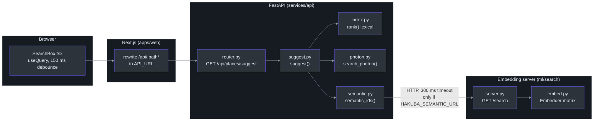
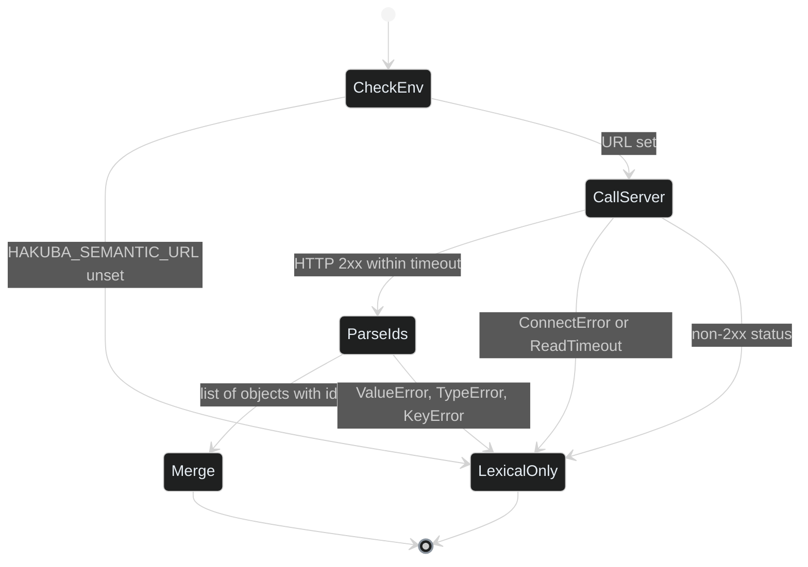
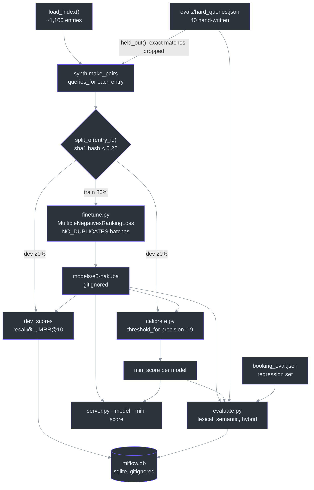
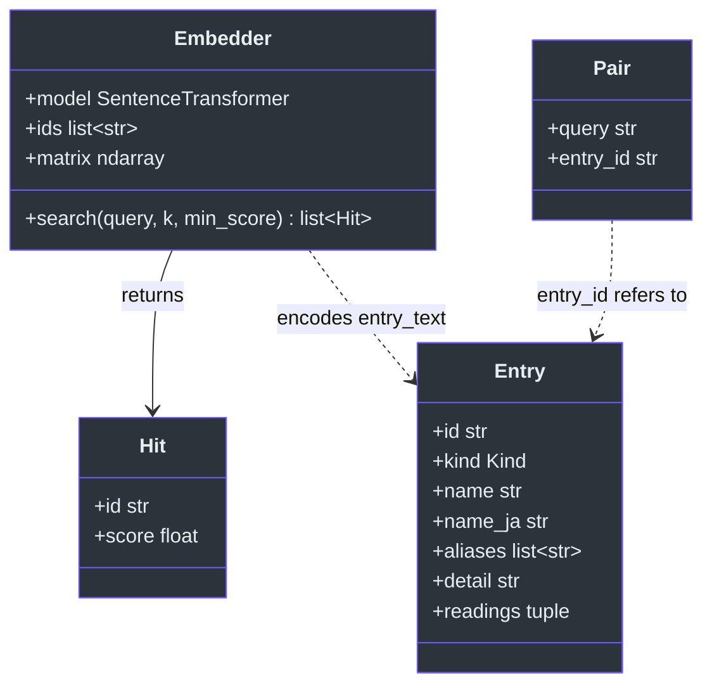

# Semantic Place Search

## Overview

**Why it exists.** The place search box is backed by a **lexical index**: about 1,100 entries (bus stops, resorts, lodging, POIs) matched by name tokens, readings and aliases. It scores 26/26 on the Booking.com regression set, but it cannot match a query whose words are not spelled in any name: Chinese resort names (八方尾根滑雪場), food or shop categories (ramen, 拉麵, コンビニ), or translated hotel names ([SPEC-place-search.md:106](https://github.com/r03922123/jp_ski_map/blob/main/SPEC-place-search.md#L106)). A multilingual sentence-embedding model can bridge that gap, so v1.4 adds **semantic retrieval beside the lexical index**, not in place of it.

**Status.** It is an experiment. Semantic search is **off** unless the API process has the `HAKUBA_SEMANTIC_URL` environment variable, and the spec keeps it off in production until the training data is rebalanced and judged on a new held-out set ([SPEC-place-search.md:142](https://github.com/r03922123/jp_ski_map/blob/main/SPEC-place-search.md#L142)).

| Question | Answer | Source |
|---|---|---|
| What model? | `intfloat/multilingual-e5-small`, or a fine-tuned copy under `ml/search/models/` | [embed.py:10](https://github.com/r03922123/jp_ski_map/blob/main/ml/search/src/hakuba_search/embed.py#L10) |
| Where does it run? | A separate FastAPI process on `127.0.0.1` (default port 8032) | [server.py:46](https://github.com/r03922123/jp_ski_map/blob/main/ml/search/src/hakuba_search/server.py#L46), [server.py:56](https://github.com/r03922123/jp_ski_map/blob/main/ml/search/src/hakuba_search/server.py#L56) |
| How is it switched on? | `HAKUBA_SEMANTIC_URL` set in the API's environment | [semantic.py:16-18](https://github.com/r03922123/jp_ski_map/blob/main/services/api/src/hakuba_api/places/semantic.py#L16-L18) |
| What if it is down or slow? | 300 ms timeout; any error returns `[]` and the page is lexical only | [semantic.py:11](https://github.com/r03922123/jp_ski_map/blob/main/services/api/src/hakuba_api/places/semantic.py#L11), [semantic.py:24-26](https://github.com/r03922123/jp_ski_map/blob/main/services/api/src/hakuba_api/places/semantic.py#L24-L26) |
| Does the web app know? | No. The web calls `/api/places/suggest` either way | [api.ts:97-100](https://github.com/r03922123/jp_ski_map/blob/main/apps/web/src/lib/api.ts#L97-L100) |
| Vector database? | None: ~1,100 normalised vectors in one NumPy matrix, exact dot product | [embed.py:38-48](https://github.com/r03922123/jp_ski_map/blob/main/ml/search/src/hakuba_search/embed.py#L38-L48) |

## Architecture

Three processes take part at query time, and one offline toolchain produces the model and the threshold the server is started with.


<!-- Sources: apps/web/src/components/SearchBox.tsx:12, apps/web/src/components/SearchBox.tsx:141-148, apps/web/next.config.ts:45-46, services/api/src/hakuba_api/places/router.py:33-46, services/api/src/hakuba_api/places/suggest.py:90-125, services/api/src/hakuba_api/places/semantic.py:14-29, ml/search/src/hakuba_search/server.py:36-41 -->

**Key engineering choice: one source of truth for the index.** The embedding server does not keep its own copy of the place data. `ml/search` declares `hakuba-api` as an editable path dependency ([pyproject.toml:7](https://github.com/r03922123/jp_ski_map/blob/main/ml/search/pyproject.toml#L7), [pyproject.toml:15](https://github.com/r03922123/jp_ski_map/blob/main/ml/search/pyproject.toml#L15)) and builds its matrix from the same `load_index()` the API uses ([server.py:12](https://github.com/r03922123/jp_ski_map/blob/main/ml/search/src/hakuba_search/server.py#L12), [server.py:27](https://github.com/r03922123/jp_ski_map/blob/main/ml/search/src/hakuba_search/server.py#L27)). So the only thing that crosses the wire is an entry `id`, and the API turns ids back into full suggestions from its own index.

| Design option | Chosen? | Why | Source |
|---|---|---|---|
| Separate embedding process, called over HTTP | Yes | Keeps torch and the model out of the API bundle (the API ships to Vercel); the API stays lexical-only by default | [SPEC-place-search.md:108-110](https://github.com/r03922123/jp_ski_map/blob/main/SPEC-place-search.md#L108-L110) |
| Exact cosine as one matrix product | Yes | ~1,100 vectors fit in memory; no ANN index or vector DB needed | [SPEC-place-search.md:109](https://github.com/r03922123/jp_ski_map/blob/main/SPEC-place-search.md#L109) |
| Reciprocal rank fusion (RRF, k=60) | Dropped | Put a look-alike ("Hakuba Grace Inn") above the exact "Hotel Grace Hakuba"; booking hits 26 → 25 | [SPEC-place-search.md:112](https://github.com/r03922123/jp_ski_map/blob/main/SPEC-place-search.md#L112), [suggest.py:113-114](https://github.com/r03922123/jp_ski_map/blob/main/services/api/src/hakuba_api/places/suggest.py#L113-L114) |
| Append semantic hits after lexical and Photon | Yes | Semantic hits never displace a name-checked result | [suggest.py:107-108](https://github.com/r03922123/jp_ski_map/blob/main/services/api/src/hakuba_api/places/suggest.py#L107-L108) |

The "keeps torch out of the Vercel bundle" reason is **inference**: the project `CLAUDE.md` notes the Vercel bundle is already too big for Vercel to install the package itself, and the API's semantic client imports only `httpx`. The spec itself only says "a separate local embedding server".

## Components

| Component | Role | Key identifiers | Source |
|---|---|---|---|
| `embed.py` | Builds the passage matrix and searches it | `Embedder`, `entry_text`, `QUERY`/`PASSAGE` prefixes, `device()` | [embed.py:15-49](https://github.com/r03922123/jp_ski_map/blob/main/ml/search/src/hakuba_search/embed.py#L15-L49) |
| `server.py` | HTTP wrapper: `/health`, `/search` | `MIN_SCORE`, `embedder()` lazy singleton | [server.py:18-41](https://github.com/r03922123/jp_ski_map/blob/main/ml/search/src/hakuba_search/server.py#L18-L41) |
| `semantic.py` (API) | HTTP client with timeout and fallback | `semantic_ids`, `TIMEOUT_S` | [semantic.py:11-29](https://github.com/r03922123/jp_ski_map/blob/main/services/api/src/hakuba_api/places/semantic.py#L11-L29) |
| `suggest.py` (API) | Merges lexical, Photon and semantic into one page | `suggest`, `_photon_extra`, `load_index` | [suggest.py:45-125](https://github.com/r03922123/jp_ski_map/blob/main/services/api/src/hakuba_api/places/suggest.py#L45-L125) |
| `index.py` (API) | Lexical ranking and the guards reused on semantic hits | `rank`, `names_a_place`, `fits_lodging_words` | [index.py:168-174](https://github.com/r03922123/jp_ski_map/blob/main/services/api/src/hakuba_api/places/index.py#L168-L174), [index.py:255](https://github.com/r03922123/jp_ski_map/blob/main/services/api/src/hakuba_api/places/index.py#L255) |
| `synth.py` | Synthetic (query, entry) pairs, stable 80/20 split by entry | `queries_for`, `split_of`, `make_pairs`, `held_out` | [synth.py:53-117](https://github.com/r03922123/jp_ski_map/blob/main/ml/search/src/hakuba_search/synth.py#L53-L117) |
| `finetune.py` | Contrastive fine-tune, dev recall@1 / MRR@10 before and after | `dev_scores`, `main` | [finetune.py:28-99](https://github.com/r03922123/jp_ski_map/blob/main/ml/search/src/hakuba_search/finetune.py#L28-L99) |
| `calibrate.py` | Per-model cosine threshold at a target precision | `threshold_for` | [calibrate.py:18-27](https://github.com/r03922123/jp_ski_map/blob/main/ml/search/src/hakuba_search/calibrate.py#L18-L27) |
| `evaluate.py` | Lexical vs semantic vs hybrid on the hard set and booking set; logs to MLflow | `matches`, `searcher`, `run`, `main` | [evaluate.py:35-111](https://github.com/r03922123/jp_ski_map/blob/main/ml/search/src/hakuba_search/evaluate.py#L35-L111) |
| `SearchBox.tsx` (web) | Debounced search-as-you-type, unaware of semantic | `useQuery(["suggest", query, near])` | [SearchBox.tsx:141-148](https://github.com/r03922123/jp_ski_map/blob/main/apps/web/src/components/SearchBox.tsx#L141-L148) |

### The service contract

The contract between API and embedding server is small, and both sides validate it.

| Side | Request / response | Validation | Source |
|---|---|---|---|
| Server | `GET /search?q=&k=` | `q`: 1–200 chars; `k`: 1–20 (default 8) | [server.py:37-40](https://github.com/r03922123/jp_ski_map/blob/main/ml/search/src/hakuba_search/server.py#L37-L40) |
| Server | `[{"id": str, "score": float}]`, best first, only scores `>= MIN_SCORE` | `score` rounded to 4 places | [server.py:41](https://github.com/r03922123/jp_ski_map/blob/main/ml/search/src/hakuba_search/server.py#L41), [embed.py:48-49](https://github.com/r03922123/jp_ski_map/blob/main/ml/search/src/hakuba_search/embed.py#L48-L49) |
| Server | `GET /health` → `{"status": "ok", "entries": N}` | – | [server.py:31-33](https://github.com/r03922123/jp_ski_map/blob/main/ml/search/src/hakuba_search/server.py#L31-L33) |
| Client | Reads only `hit["id"]`; ignores `score` | Non-2xx, bad JSON, wrong shape → `[]` | [semantic.py:21-26](https://github.com/r03922123/jp_ski_map/blob/main/services/api/src/hakuba_api/places/semantic.py#L21-L26) |
| Client | Unknown ids (not in the API's index) | Silently skipped | [suggest.py:116-118](https://github.com/r03922123/jp_ski_map/blob/main/services/api/src/hakuba_api/places/suggest.py#L116-L118) |

Two consequences you can derive from the code (**inference**, not tested directly):

- The API accepts queries up to `MAX_QUERY_CHARS = 2048` ([params.py:14](https://github.com/r03922123/jp_ski_map/blob/main/services/api/src/hakuba_api/common/params.py#L14)) but the server rejects `q` over 200 chars with a 422. `raise_for_status()` turns that into an `httpx.HTTPStatusError`, which is an `httpx.HTTPError`, so a long query falls back to lexical rather than failing the request.
- If the place data is refreshed and the API restarts but the embedding server does not, the server may return ids the API no longer has. `known.get(i)` returns `None` and the hit is dropped, so a stale server degrades quality, not correctness.

### The server's threshold

`MIN_SCORE` comes from `HAKUBA_SEMANTIC_MIN_SCORE` (default `0.9127`, the base model's calibrated value) or the `--min-score` flag ([server.py:18](https://github.com/r03922123/jp_ski_map/blob/main/ml/search/src/hakuba_search/server.py#L18), [server.py:52-53](https://github.com/r03922123/jp_ski_map/blob/main/ml/search/src/hakuba_search/server.py#L52-L53)). The model comes from `--model`, passed through `HAKUBA_EMBED_MODEL` ([server.py:50-51](https://github.com/r03922123/jp_ski_map/blob/main/ml/search/src/hakuba_search/server.py#L50-L51), [embed.py:35](https://github.com/r03922123/jp_ski_map/blob/main/ml/search/src/hakuba_search/embed.py#L35)). The two must be changed together: fine-tuning moved the calibrated score from 0.9127 to 0.5387 ([README.md:12](https://github.com/r03922123/jp_ski_map/blob/main/ml/search/README.md#L12)), so the base model's default threshold would filter out almost every hit from the fine-tuned model. Nothing in the code enforces that pairing; it is a run-time convention documented in the README commands ([README.md:25](https://github.com/r03922123/jp_ski_map/blob/main/ml/search/README.md#L25)).

## Data Flow

### One keystroke, end to end


<!-- Sources: apps/web/src/components/SearchBox.tsx:12, apps/web/src/components/SearchBox.tsx:126, apps/web/src/components/SearchBox.tsx:141-148, apps/web/src/lib/api.ts:97-100, apps/web/next.config.ts:45-46, services/api/src/hakuba_api/places/router.py:33-46, services/api/src/hakuba_api/places/suggest.py:97-125, services/api/src/hakuba_api/places/suggest.py:128-144, services/api/src/hakuba_api/places/semantic.py:14-29 -->

Notes on ordering (read from the code):

- The semantic call is **skipped** when lexical hits already fill the page, because semantic hits are only appended and would be cut anyway ([suggest.py:100-101](https://github.com/r03922123/jp_ski_map/blob/main/services/api/src/hakuba_api/places/suggest.py#L100-L101)).
- The semantic call is made **before** the Chinese-hotel-word retry and before Photon. The calls are sequential, not concurrent, so a slow server adds up to the timeout to the request ([suggest.py:101-109](https://github.com/r03922123/jp_ski_map/blob/main/services/api/src/hakuba_api/places/suggest.py#L101-L109)). The spec adds that httpx applies the 300 ms per phase (connect, read), so a slow server can hold a request a little longer ([SPEC-place-search.md:110](https://github.com/r03922123/jp_ski_map/blob/main/SPEC-place-search.md#L110)).
- Photon's decision uses only the lexical count, never the semantic count ([suggest.py:130](https://github.com/r03922123/jp_ski_map/blob/main/services/api/src/hakuba_api/places/suggest.py#L130)).

### The fallback, as a state machine


<!-- Sources: services/api/src/hakuba_api/places/semantic.py:16-29, services/api/tests/places/test_semantic.py:23-59 -->

`LexicalOnly` here means `semantic_ids` returned `[]`; `suggest()` then builds its page from lexical and Photon as before v1.4. Every branch is pinned by a unit test that uses `respx` to mock the server:

| Fallback case | Test | Source |
|---|---|---|
| No URL → no network call at all | `test_no_server_configured_makes_no_call` | [test_semantic.py:23-28](https://github.com/r03922123/jp_ski_map/blob/main/services/api/tests/places/test_semantic.py#L23-L28) |
| Ids returned in server order, `k` forwarded | `test_server_hits_come_back_as_ids_in_order` | [test_semantic.py:31-39](https://github.com/r03922123/jp_ski_map/blob/main/services/api/tests/places/test_semantic.py#L31-L39) |
| Server down (`ConnectError`) or slow (`ReadTimeout`) | `test_server_down_or_slow_falls_back_to_nothing` | [test_semantic.py:42-51](https://github.com/r03922123/jp_ski_map/blob/main/services/api/tests/places/test_semantic.py#L42-L51) |
| Wrong JSON shape (`{"oops": 1}`) | `test_malformed_server_reply_falls_back_to_nothing` | [test_semantic.py:54-59](https://github.com/r03922123/jp_ski_map/blob/main/services/api/tests/places/test_semantic.py#L54-L59) |

The malformed case works because iterating a dict yields its string keys, and `"oops"["id"]` raises `TypeError`, which is in the caught tuple ([semantic.py:23-24](https://github.com/r03922123/jp_ski_map/blob/main/services/api/src/hakuba_api/places/semantic.py#L23-L24)).

**Where is it set?** `git grep HAKUBA_SEMANTIC_URL` finds it only in `semantic.py`, `server.py`'s docstring, the README, `CLAUDE.md`, the spec and the tests; no deploy script or config sets it. Since the server binds `127.0.0.1` only, a hosted API could not reach it anyway (**inference**). Production status: (Unknown – verify in the Vercel project's environment variables; not in the repo).

### Offline pipeline: from index to a served model


<!-- Sources: ml/search/src/hakuba_search/synth.py:53-56, ml/search/src/hakuba_search/synth.py:102-117, ml/search/src/hakuba_search/finetune.py:28-99, ml/search/src/hakuba_search/calibrate.py:18-47, ml/search/src/hakuba_search/evaluate.py:91-111, ml/search/.gitignore:1-3, ml/search/README.md:18-27 -->

## Implementation

### Embedding and search

`entry_text` joins `name | name_ja | aliases | detail`, de-duplicated in order with `dict.fromkeys` ([embed.py:15-17](https://github.com/r03922123/jp_ski_map/blob/main/ml/search/src/hakuba_search/embed.py#L15-L17)). e5 expects `"query: "` and `"passage: "` prefixes ([embed.py:11-12](https://github.com/r03922123/jp_ski_map/blob/main/ml/search/src/hakuba_search/embed.py#L11-L12)); every encode site in the package uses them, including training anchors and positives ([finetune.py:65-66](https://github.com/r03922123/jp_ski_map/blob/main/ml/search/src/hakuba_search/finetune.py#L65-L66)), so train and serve see the same input format.

```python
# embed.py, Embedder.search (abridged)
q = model.encode(["query: " + query], normalize_embeddings=True)
scores = matrix @ q[0]                 # cosine, because both sides are L2-normalised
top = np.argsort(-scores)[:k]          # full sort of ~1,100 floats: cheap
return [Hit(ids[i], scores[i]) for i in top if scores[i] >= min_score]
```

Serving details worth knowing:

| Concern | What the code does | Source |
|---|---|---|
| Cold start | `embedder()` is called before `uvicorn.run`, so the matrix is built before the first request | [server.py:54](https://github.com/r03922123/jp_ski_map/blob/main/ml/search/src/hakuba_search/server.py#L54) |
| Device | MPS (Apple GPU) when available, else CPU | [embed.py:20-23](https://github.com/r03922123/jp_ski_map/blob/main/ml/search/src/hakuba_search/embed.py#L20-L23) |
| Network exposure | Binds `127.0.0.1` only | [server.py:56](https://github.com/r03922123/jp_ski_map/blob/main/ml/search/src/hakuba_search/server.py#L56) |
| Privacy | uvicorn access log off (it would print `?q=`); the API logs only timing and hit count | [server.py:55-56](https://github.com/r03922123/jp_ski_map/blob/main/ml/search/src/hakuba_search/server.py#L55-L56), [semantic.py:27-28](https://github.com/r03922123/jp_ski_map/blob/main/services/api/src/hakuba_api/places/semantic.py#L27-L28) |
| Warning log on failure | Logs the exception type name only, not the message | [semantic.py:25](https://github.com/r03922123/jp_ski_map/blob/main/services/api/src/hakuba_api/places/semantic.py#L25) |

### Merging semantic hits safely

Semantic hits carry no name check, so `suggest()` puts them last and filters them with the same guards it applies to Photon ([suggest.py:115-124](https://github.com/r03922123/jp_ski_map/blob/main/services/api/src/hakuba_api/places/suggest.py#L115-L124)):

```python
for i in meaning:                                   # ids from the embedding server
    e = known.get(i)
    if e is None or i in seen or near_a_photon_hit(e):
        continue
    names = [e.name, e.name_ja]
    # lodging and bus stops must share a distinctive word with the query
    named = e.kind not in ("lodging", "stop") or names_a_place(query, names)
    if named and fits_lodging_words(query, e.kind, names):
        page.append(e)
return page[:limit]                                 # cut once, after everything
```

| Guard | Why | Source |
|---|---|---|
| `names_a_place` for lodging and stops | A look-alike hotel is a confidently wrong answer; a query of only area and generic words names no place | [index.py:168-171](https://github.com/r03922123/jp_ski_map/blob/main/services/api/src/hakuba_api/places/index.py#L168-L171) |
| `fits_lodging_words` | "Hakuba Park Hotel" must not answer with the "… Parking" bus stop | [index.py:174-177](https://github.com/r03922123/jp_ski_map/blob/main/services/api/src/hakuba_api/places/index.py#L174-L177) |
| `_close` to a Photon hit (50 m box) | No duplicate pin for the same place from two sources | [suggest.py:86-87](https://github.com/r03922123/jp_ski_map/blob/main/services/api/src/hakuba_api/places/suggest.py#L86-L87) |

Food, shop, resort and POI kinds skip the name check on purpose: that is where meaning-based recall pays off ("ramen" → a ramen shop). These merge rules have their own unit tests in `test_semantic.py` (for example `test_suggest_drops_a_semantic_lodging_that_shares_no_word`, [test_semantic.py:76](https://github.com/r03922123/jp_ski_map/blob/main/services/api/tests/places/test_semantic.py#L76)).

### Training data synthesis

| Rule in `queries_for` | Example of what it mimics | Source |
|---|---|---|
| Name and Japanese name as-is | exact typing | [synth.py:80-81](https://github.com/r03922123/jp_ski_map/blob/main/ml/search/src/hakuba_search/synth.py#L80-L81) |
| Drop area words (`Hakuba`, `白馬`) | "Grace" for "Hotel Grace Hakuba" | [synth.py:82-84](https://github.com/r03922123/jp_ski_map/blob/main/ml/search/src/hakuba_search/synth.py#L82-L84) |
| One-letter typo (drop, swap, double) | fat fingers | [synth.py:59-69](https://github.com/r03922123/jp_ski_map/blob/main/ml/search/src/hakuba_search/synth.py#L59-L69) |
| Japanese → Traditional Chinese words | スキー場 → 滑雪場 | [synth.py:21](https://github.com/r03922123/jp_ski_map/blob/main/ml/search/src/hakuba_search/synth.py#L21), [synth.py:72-75](https://github.com/r03922123/jp_ski_map/blob/main/ml/search/src/hakuba_search/synth.py#L72-L75) |
| Romaji readings and aliases | "hotel guresu hakuba" | [synth.py:88-89](https://github.com/r03922123/jp_ski_map/blob/main/ml/search/src/hakuba_search/synth.py#L88-L89) |
| Cuisine words from `detail` | "ramen", 拉麵 for a ramen shop | [synth.py:22-37](https://github.com/r03922123/jp_ski_map/blob/main/ml/search/src/hakuba_search/synth.py#L22-L37), [synth.py:90-93](https://github.com/r03922123/jp_ski_map/blob/main/ml/search/src/hakuba_search/synth.py#L90-L93) |
| Kind words | "konbini", "bus stop" | [synth.py:38-43](https://github.com/r03922123/jp_ski_map/blob/main/ml/search/src/hakuba_search/synth.py#L38-L43), [synth.py:94-98](https://github.com/r03922123/jp_ski_map/blob/main/ml/search/src/hakuba_search/synth.py#L94-L98) |

Two leakage controls are worth copying into any project:

1. **Split by entry, not by pair.** `split_of` hashes the entry id with SHA-1, so every query for one entry lands on the same side and the dev set holds names the model never trained on. The hash is stable across runs and machines, unlike a seeded shuffle that changes when the index grows ([synth.py:53-56](https://github.com/r03922123/jp_ski_map/blob/main/ml/search/src/hakuba_search/synth.py#L53-L56)).
2. **Drop test queries from training.** `make_pairs` removes any query whose normalised form equals one in `hard_queries.json` ([synth.py:102-117](https://github.com/r03922123/jp_ski_map/blob/main/ml/search/src/hakuba_search/synth.py#L102-L117)), and a test asserts it ([test_synth_eval.py:85](https://github.com/r03922123/jp_ski_map/blob/main/ml/search/tests/test_synth_eval.py#L85)). The first fine-tune had 13 of the 40 hard queries word for word in its training pairs ([SPEC-place-search.md:117](https://github.com/r03922123/jp_ski_map/blob/main/SPEC-place-search.md#L117)). Near-duplicates ("ramen hakuba") can remain ([synth.py:5-7](https://github.com/r03922123/jp_ski_map/blob/main/ml/search/src/hakuba_search/synth.py#L5-L7)).

### Fine-tuning

`finetune.py` uses `SentenceTransformerTrainer` with `MultipleNegativesRankingLoss` (in-batch negatives) and `BatchSamplers.NO_DUPLICATES`, because two queries for the same entry in one batch would be scored as each other's negatives ([finetune.py:75-76](https://github.com/r03922123/jp_ski_map/blob/main/ml/search/src/hakuba_search/finetune.py#L75-L76), [finetune.py:82-87](https://github.com/r03922123/jp_ski_map/blob/main/ml/search/src/hakuba_search/finetune.py#L82-L87)). Defaults: 1 epoch, batch 32, lr 2e-5, warmup 10%, seed 0 ([finetune.py:48-50](https://github.com/r03922123/jp_ski_map/blob/main/ml/search/src/hakuba_search/finetune.py#L48-L50), [finetune.py:70-80](https://github.com/r03922123/jp_ski_map/blob/main/ml/search/src/hakuba_search/finetune.py#L70-L80)).

`dev_scores` retrieves each dev query against the **whole** index, so train entries act as distractors; this is closer to serving than scoring against dev entries only ([finetune.py:28-41](https://github.com/r03922123/jp_ski_map/blob/main/ml/search/src/hakuba_search/finetune.py#L28-L41)). It runs before and after training on the same model object.

### Threshold calibration

A cosine score only means something relative to one model. `threshold_for` sorts dev top-1 answers by score, walks down, and keeps the lowest score at which the cumulative precision of that prefix is `>= precision` (any prefix, not stopping at the first dip) (default 0.9) ([calibrate.py:18-27](https://github.com/r03922123/jp_ski_map/blob/main/ml/search/src/hakuba_search/calibrate.py#L18-L27), [calibrate.py:33](https://github.com/r03922123/jp_ski_map/blob/main/ml/search/src/hakuba_search/calibrate.py#L33)). It calibrates on the synthetic dev split, never on the hard set or booking set, so the test sets stay untouched. It returns `inf` when no prefix reaches the target, which would make the server return nothing.

The spec's result shows why this matters: the base model's guessed threshold (0.84) scored hit@5 0.65 on the hard set, but its calibrated threshold (0.9127) kept almost nothing (0.15, same as lexical); the fine-tuned model is usable at its calibrated 0.5387 (0.55) ([SPEC-place-search.md:128-134](https://github.com/r03922123/jp_ski_map/blob/main/SPEC-place-search.md#L128-L134)).

### How evals are wired

| Piece | What it does | Source |
|---|---|---|
| Hard set | 40 hand-written queries in 4 groups (`category`, `hotel`, `resort-en`, `resort-zh`); a case passes by `id_prefix`, `detail_any`, `kind` or `name_any` | [evaluate.py:35-44](https://github.com/r03922123/jp_ski_map/blob/main/ml/search/src/hakuba_search/evaluate.py#L35-L44) |
| `searcher("semantic")` | Embedder only, no `suggest()` | [evaluate.py:58-59](https://github.com/r03922123/jp_ski_map/blob/main/ml/search/src/hakuba_search/evaluate.py#L58-L59) |
| `searcher("hybrid" / "lexical")` | **Monkeypatches** `semantic.semantic_ids` with the in-process embedder (or a stub returning `[]`), then calls the real `suggest()` with Photon off | [evaluate.py:60-61](https://github.com/r03922123/jp_ski_map/blob/main/ml/search/src/hakuba_search/evaluate.py#L60-L61) |
| Booking regression | Non-semantic modes also run `eval_search.evaluate()` and record hit / ok-absent / wrong counts | [evaluate.py:82-86](https://github.com/r03922123/jp_ski_map/blob/main/ml/search/src/hakuba_search/evaluate.py#L82-L86), [eval_search.py:49-56](https://github.com/r03922123/jp_ski_map/blob/main/services/api/src/hakuba_api/places/eval_search.py#L49-L56) |
| Metrics | hit@1, hit@5, p50/p95 latency, hit@5 per group, misses list | [evaluate.py:73-87](https://github.com/r03922123/jp_ski_map/blob/main/ml/search/src/hakuba_search/evaluate.py#L73-L87) |
| MLflow | SQLite store `ml/search/mlflow.db`; experiment `place-search` (one run per mode) and `place-search-finetune` | [evaluate.py:101-109](https://github.com/r03922123/jp_ski_map/blob/main/ml/search/src/hakuba_search/evaluate.py#L101-L109), [finetune.py:93-99](https://github.com/r03922123/jp_ski_map/blob/main/ml/search/src/hakuba_search/finetune.py#L93-L99) |
| Required flag | `--min-score` has no default: a shared value "silently filters all" | [evaluate.py:96-97](https://github.com/r03922123/jp_ski_map/blob/main/ml/search/src/hakuba_search/evaluate.py#L96-L97) |

The monkeypatch works because `suggest.py` imports the module and calls `semantic.semantic_ids(...)` through it ([suggest.py:10](https://github.com/r03922123/jp_ski_map/blob/main/services/api/src/hakuba_api/places/suggest.py#L10), [suggest.py:101](https://github.com/r03922123/jp_ski_map/blob/main/services/api/src/hakuba_api/places/suggest.py#L101)); a `from ... import semantic_ids` would have bound the original function and the patch would do nothing. The trade-off: hybrid eval numbers skip the HTTP hop and the 300 ms timeout, so they overstate live quality on a loaded Mac ([SPEC-place-search.md:140](https://github.com/r03922123/jp_ski_map/blob/main/SPEC-place-search.md#L140)).


<!-- Sources: ml/search/src/hakuba_search/embed.py:26-49, ml/search/src/hakuba_search/synth.py:47-50, services/api/src/hakuba_api/places/index.py:75-84 -->

### Known discrepancy

The spec says the MLflow store is `ml/search/mlruns` ([SPEC-place-search.md:114](https://github.com/r03922123/jp_ski_map/blob/main/SPEC-place-search.md#L114)), but both scripts write to a SQLite file `ml/search/mlflow.db` ([evaluate.py:101](https://github.com/r03922123/jp_ski_map/blob/main/ml/search/src/hakuba_search/evaluate.py#L101), [finetune.py:93](https://github.com/r03922123/jp_ski_map/blob/main/ml/search/src/hakuba_search/finetune.py#L93)). Both paths are gitignored ([.gitignore:2-3](https://github.com/r03922123/jp_ski_map/blob/main/ml/search/.gitignore#L2-L3)). The code and README are the current truth.

### The web side

`SearchBox` does not know semantic search exists. It debounces typed text by 150 ms ([SearchBox.tsx:12](https://github.com/r03922123/jp_ski_map/blob/main/apps/web/src/components/SearchBox.tsx#L12), [SearchBox.tsx:126](https://github.com/r03922123/jp_ski_map/blob/main/apps/web/src/components/SearchBox.tsx#L126)), queries through TanStack Query with `retry: false`, a 60 s `staleTime` and the previous rows kept while the next keystroke loads ([SearchBox.tsx:141-148](https://github.com/r03922123/jp_ski_map/blob/main/apps/web/src/components/SearchBox.tsx#L141-L148)), and puts saved places above server rows ([SearchBox.tsx:150-157](https://github.com/r03922123/jp_ski_map/blob/main/apps/web/src/components/SearchBox.tsx#L150-L157)). A semantic hit arrives as an ordinary `Suggestion` with `source: "index"`, because `_from_entry` sets that for every index entry ([suggest.py:55-65](https://github.com/r03922123/jp_ski_map/blob/main/services/api/src/hakuba_api/places/suggest.py#L55-L65)), and with `match: null`, so no span is bolded. Telling semantic rows apart in the UI is not possible from the response today (**inference** from the response model).

## References

| File | What to read it for |
|---|---|
| [SPEC-place-search.md](https://github.com/r03922123/jp_ski_map/blob/main/SPEC-place-search.md#L104) | v1.4 design, acceptance, results table and caveats |
| [ml/search/README.md](https://github.com/r03922123/jp_ski_map/blob/main/ml/search/README.md) | Exact command sequence: calibrate → evaluate → finetune → serve |
| [ml/search/src/hakuba_search/server.py](https://github.com/r03922123/jp_ski_map/blob/main/ml/search/src/hakuba_search/server.py) | Embedding server |
| [ml/search/src/hakuba_search/embed.py](https://github.com/r03922123/jp_ski_map/blob/main/ml/search/src/hakuba_search/embed.py) | Model, prefixes, cosine search |
| [ml/search/src/hakuba_search/synth.py](https://github.com/r03922123/jp_ski_map/blob/main/ml/search/src/hakuba_search/synth.py) | Synthetic pairs and split |
| [ml/search/src/hakuba_search/finetune.py](https://github.com/r03922123/jp_ski_map/blob/main/ml/search/src/hakuba_search/finetune.py) | Contrastive training |
| [ml/search/src/hakuba_search/calibrate.py](https://github.com/r03922123/jp_ski_map/blob/main/ml/search/src/hakuba_search/calibrate.py) | Threshold choice |
| [ml/search/src/hakuba_search/evaluate.py](https://github.com/r03922123/jp_ski_map/blob/main/ml/search/src/hakuba_search/evaluate.py) | Three-mode eval and MLflow logging |
| [services/api/src/hakuba_api/places/semantic.py](https://github.com/r03922123/jp_ski_map/blob/main/services/api/src/hakuba_api/places/semantic.py) | API client and fallback |
| [services/api/src/hakuba_api/places/suggest.py](https://github.com/r03922123/jp_ski_map/blob/main/services/api/src/hakuba_api/places/suggest.py) | Page assembly |
| [services/api/tests/places/test_semantic.py](https://github.com/r03922123/jp_ski_map/blob/main/services/api/tests/places/test_semantic.py) | Fallback and merge tests |
| [ml/search/tests/test_synth_eval.py](https://github.com/r03922123/jp_ski_map/blob/main/ml/search/tests/test_synth_eval.py) | Split, leak and threshold tests |
| [apps/web/src/components/SearchBox.tsx](https://github.com/r03922123/jp_ski_map/blob/main/apps/web/src/components/SearchBox.tsx) | The client |

## Related Pages

| Page | Relationship |
|---|---|
| [Routing and ETA](../01-routing/routing-and-eta.md) | Consumes the place a user picks here (inference: verify how the picked `coord` is passed in `apps/web/src/components/TripPanel.tsx`) |
| [Bus Schedules](../02-bus/bus-schedules.md) | Bus stops are index entries; semantic stop hits pass the same name guard |
| [Crowd Level](../04-crowd/crowd-level.md) | Resorts are index entries here; crowd levels are per resort (sibling page) |
