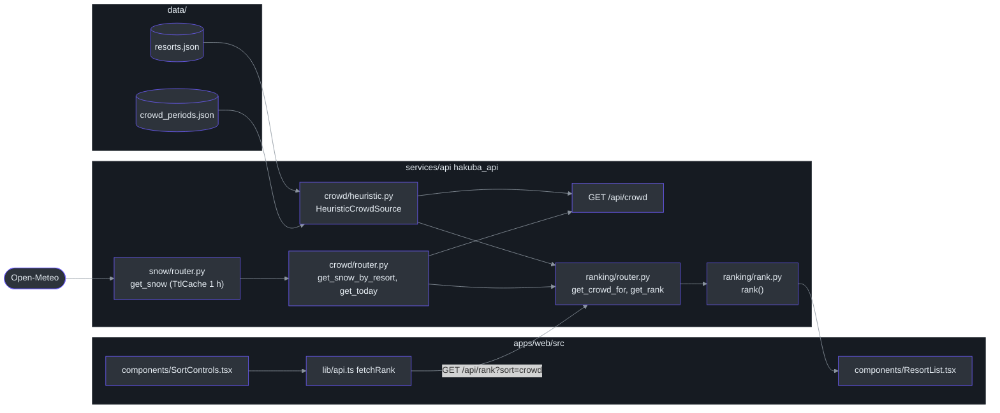
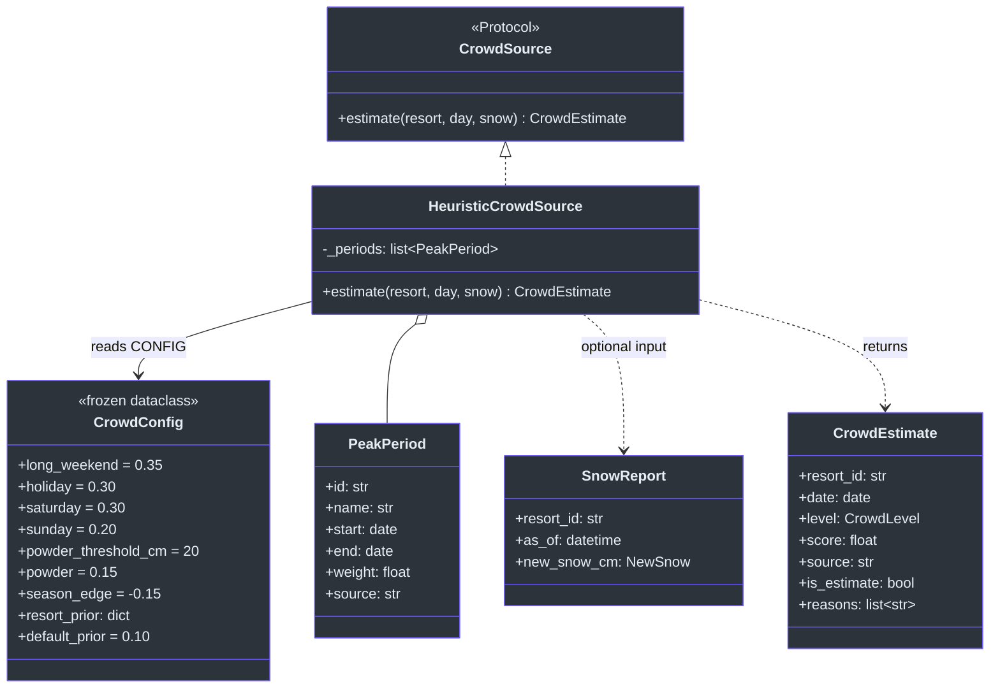
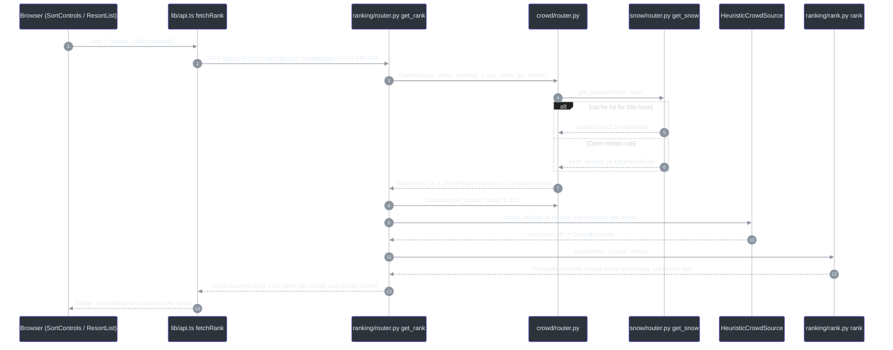
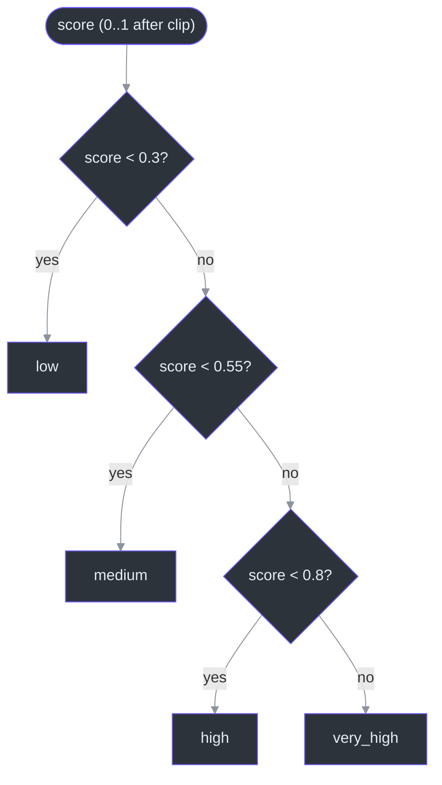

# Crowd Level

The crowd level is a **0–1 score plus a label** (`low`, `medium`, `high`, `very_high`) for each resort on one date, with a list of plain-English **reasons**. It is computed by a hand-weighted **heuristic** (a fixed rule with tuned numbers, no training) in `services/api/src/hakuba_api/crowd/`, and it reaches the screen inside the resort ranking response, not through its own endpoint.

## Overview: why a heuristic

| Question | Answer | Source |
|---|---|---|
| What problem does it solve? | A skier choosing between ten resorts wants to avoid queues; no open crowd data exists for Hakuba | [SPEC-crowd-level.md:6](https://github.com/r03922123/jp_ski_map/blob/main/SPEC-crowd-level.md#L6), [SPEC-crowd-level.md:39](https://github.com/r03922123/jp_ski_map/blob/main/SPEC-crowd-level.md#L39) |
| Why not a model? | There is no labelled data to train or calibrate on. The SPEC asks for an **explainable** v1 where every factor is visible, and forbids scraping Google Popular Times | [SPEC-crowd-level.md:6](https://github.com/r03922123/jp_ski_map/blob/main/SPEC-crowd-level.md#L6), [SPEC-crowd-level.md:37](https://github.com/r03922123/jp_ski_map/blob/main/SPEC-crowd-level.md#L37) |
| How can it improve later? | The source is a `Protocol`; a data-driven source can replace `HeuristicCrowdSource` without changing the API shape | [crowd/models.py:30-33](https://github.com/r03922123/jp_ski_map/blob/main/services/api/src/hakuba_api/crowd/models.py#L30-L33) |
| Why do weights look arbitrary? | They are. ADR-0001 kept holiday = Saturday (0.30 each) because "no data supports either order" | [docs/adr/0001-follow-ups-1-2-3-5.md:52-60](https://github.com/r03922123/jp_ski_map/blob/main/docs/adr/0001-follow-ups-1-2-3-5.md#L52-L60) |
| How honest is the UI? | Every place it appears carries "(est.)" or "(estimated)" and the reasons | [ResortList.tsx:127-131](https://github.com/r03922123/jp_ski_map/blob/main/apps/web/src/components/ResortList.tsx#L127-L131), [SortControls.tsx:10](https://github.com/r03922123/jp_ski_map/blob/main/apps/web/src/components/SortControls.tsx#L10) |

For an ML reader: think of this as a **linear model with hand-set coefficients and one-hot-ish features** (day type, peak period, powder flag, resort prior, season edge), followed by `clip(0, 1)` and fixed bucket thresholds. There is no fitting step. The SPEC's research backlog lists data that could later calibrate it, such as Nagano tourism visitor statistics for the resort prior ([SPEC-crowd-level.md:39](https://github.com/r03922123/jp_ski_map/blob/main/SPEC-crowd-level.md#L39)).

## Architecture

| Layer | Piece | Role | Source |
|---|---|---|---|
| Data | `data/crowd_periods.json` | Dated peak periods with their own weight | [data/crowd_periods.json:1-8](https://github.com/r03922123/jp_ski_map/blob/main/data/crowd_periods.json#L1-L8) |
| Logic | `crowd/heuristic.py` | `CrowdConfig`, `load_periods`, `level_for`, `HeuristicCrowdSource` | [crowd/heuristic.py:17-157](https://github.com/r03922123/jp_ski_map/blob/main/services/api/src/hakuba_api/crowd/heuristic.py#L17-L157) |
| Types | `crowd/models.py` | `CrowdEstimate`, `PeakPeriod`, `CrowdSource`, `CrowdLevel` | [crowd/models.py:8-33](https://github.com/r03922123/jp_ski_map/blob/main/services/api/src/hakuba_api/crowd/models.py#L8-L33) |
| HTTP | `crowd/router.py` | `GET /api/crowd`, plus `get_today` and `get_snow_by_resort` reused by ranking | [crowd/router.py:18-39](https://github.com/r03922123/jp_ski_map/blob/main/services/api/src/hakuba_api/crowd/router.py#L18-L39) |
| Input | `snow/` | Open-Meteo snow reports, cached 1 h | [snow/router.py:17](https://github.com/r03922123/jp_ski_map/blob/main/services/api/src/hakuba_api/snow/router.py#L17) |
| Consumer | `ranking/` | Builds crowd per resort inside `GET /api/rank`; sort key `crowd` | [ranking/router.py:27-35](https://github.com/r03922123/jp_ski_map/blob/main/services/api/src/hakuba_api/ranking/router.py#L27-L35) |
| UI | `apps/web` | Badge, factor row, reasons, sort option | [ResortList.tsx:31-35](https://github.com/r03922123/jp_ski_map/blob/main/apps/web/src/components/ResortList.tsx#L31-L35) |


<!-- Sources: services/api/src/hakuba_api/crowd/router.py:22-39, services/api/src/hakuba_api/crowd/heuristic.py:54-56, services/api/src/hakuba_api/ranking/router.py:9-11, services/api/src/hakuba_api/ranking/router.py:27-54, services/api/src/hakuba_api/snow/router.py:17, apps/web/src/lib/api.ts:120-127 -->

`GET /api/crowd` has no arrow into the web box on purpose: **the web app never calls it**. ADR-0001 kept the endpoint because it is the SPEC's own tested interface ([docs/adr/0001-follow-ups-1-2-3-5.md:63-71](https://github.com/r03922123/jp_ski_map/blob/main/docs/adr/0001-follow-ups-1-2-3-5.md#L63-L71)). The generated client types still list it ([api-types.ts:193](https://github.com/r03922123/jp_ski_map/blob/main/apps/web/src/lib/api-types.ts#L193)).

## Components

### Types (`crowd/models.py`)

| Type | Fields | Notes | Source |
|---|---|---|---|
| `CrowdLevel` | `"low" \| "medium" \| "high" \| "very_high"` | `Literal` type | [crowd/models.py:8](https://github.com/r03922123/jp_ski_map/blob/main/services/api/src/hakuba_api/crowd/models.py#L8) |
| `CrowdEstimate` | `resort_id`, `date`, `level`, `score`, `source`, `is_estimate=True`, `reasons` | Serialised camelCase (`resortId`, `isEstimate`) via `ApiModel` | [crowd/models.py:11-18](https://github.com/r03922123/jp_ski_map/blob/main/services/api/src/hakuba_api/crowd/models.py#L11-L18), [common/models.py:5-8](https://github.com/r03922123/jp_ski_map/blob/main/services/api/src/hakuba_api/common/models.py#L5-L8) |
| `PeakPeriod` | `id`, `name`, `start`, `end`, `weight`, `source` | One row of `crowd_periods.json`; `source` is a provenance note, not code | [crowd/models.py:21-27](https://github.com/r03922123/jp_ski_map/blob/main/services/api/src/hakuba_api/crowd/models.py#L21-L27) |
| `CrowdSource` | `estimate(resort, day, snow) -> CrowdEstimate` | `typing.Protocol`: any class with this method fits (structural typing, like duck typing checked by mypy) | [crowd/models.py:30-33](https://github.com/r03922123/jp_ski_map/blob/main/services/api/src/hakuba_api/crowd/models.py#L30-L33) |


<!-- Sources: services/api/src/hakuba_api/crowd/models.py:11-33, services/api/src/hakuba_api/crowd/heuristic.py:17-46, services/api/src/hakuba_api/crowd/heuristic.py:112-116, services/api/src/hakuba_api/snow/models.py:32-37 -->

### Configuration (`CrowdConfig` and the periods file)

| Weight | Value | Reason text added | Source |
|---|---|---|---|
| `long_weekend` | 0.35 | `3-day weekend` (+ first holiday name in the run) | [heuristic.py:19](https://github.com/r03922123/jp_ski_map/blob/main/services/api/src/hakuba_api/crowd/heuristic.py#L19), [heuristic.py:84-86](https://github.com/r03922123/jp_ski_map/blob/main/services/api/src/hakuba_api/crowd/heuristic.py#L84-L86) |
| `holiday` | 0.30 | `Public holiday (<name>)` | [heuristic.py:20](https://github.com/r03922123/jp_ski_map/blob/main/services/api/src/hakuba_api/crowd/heuristic.py#L20), [heuristic.py:87-88](https://github.com/r03922123/jp_ski_map/blob/main/services/api/src/hakuba_api/crowd/heuristic.py#L87-L88) |
| `saturday` | 0.30 | `Saturday` | [heuristic.py:21](https://github.com/r03922123/jp_ski_map/blob/main/services/api/src/hakuba_api/crowd/heuristic.py#L21) |
| `sunday` | 0.20 | `Sunday` | [heuristic.py:22](https://github.com/r03922123/jp_ski_map/blob/main/services/api/src/hakuba_api/crowd/heuristic.py#L22) |
| `powder` (if new snow ≥ `powder_threshold_cm` = 20) | 0.15 | `Powder day (N cm new)` | [heuristic.py:23-24](https://github.com/r03922123/jp_ski_map/blob/main/services/api/src/hakuba_api/crowd/heuristic.py#L23-L24), [heuristic.py:131-134](https://github.com/r03922123/jp_ski_map/blob/main/services/api/src/hakuba_api/crowd/heuristic.py#L131-L134) |
| `season_edge` | −0.15 | `Early/late season` | [heuristic.py:25](https://github.com/r03922123/jp_ski_map/blob/main/services/api/src/hakuba_api/crowd/heuristic.py#L25), [heuristic.py:145-147](https://github.com/r03922123/jp_ski_map/blob/main/services/api/src/hakuba_api/crowd/heuristic.py#L145-L147) |
| `resort_prior` | Happo-One 0.25; Goryu, Tsugaike 0.20; Hakuba47, Iwatake, Cortina 0.15; Norikura, Kashimayari 0.08; Sanosaka 0.03; Jigatake 0 | ≥ 0.20 `Large, popular resort`; ≥ 0.10 `Moderately popular resort`; > 0 `Less-visited resort` | [heuristic.py:27-43](https://github.com/r03922123/jp_ski_map/blob/main/services/api/src/hakuba_api/crowd/heuristic.py#L27-L43), [heuristic.py:136-143](https://github.com/r03922123/jp_ski_map/blob/main/services/api/src/hakuba_api/crowd/heuristic.py#L136-L143) |
| `default_prior` (resort id not in the dict) | 0.10 | `Moderately popular resort` | [heuristic.py:41](https://github.com/r03922123/jp_ski_map/blob/main/services/api/src/hakuba_api/crowd/heuristic.py#L41) |

| Peak period (`crowd_periods.json`) | Dates | Weight | Source |
|---|---|---|---|
| New Year holidays | 2025-12-28 → 2026-01-04, 2026-12-28 → 2027-01-04 | 0.35 | [data/crowd_periods.json:2](https://github.com/r03922123/jp_ski_map/blob/main/data/crowd_periods.json#L2), [:5](https://github.com/r03922123/jp_ski_map/blob/main/data/crowd_periods.json#L5) |
| Australian summer school holidays | 2025-12-19 → 2026-01-27, 2026-12-18 → 2027-01-26 | 0.15 | [data/crowd_periods.json:3](https://github.com/r03922123/jp_ski_map/blob/main/data/crowd_periods.json#L3), [:6](https://github.com/r03922123/jp_ski_map/blob/main/data/crowd_periods.json#L6) |
| Lunar New Year week | 2026-02-14 → 2026-02-22, 2027-02-03 → 2027-02-11 | 0.25 | [data/crowd_periods.json:4](https://github.com/r03922123/jp_ski_map/blob/main/data/crowd_periods.json#L4), [:7](https://github.com/r03922123/jp_ski_map/blob/main/data/crowd_periods.json#L7) |

Two design choices worth noticing:

- **Overlapping periods do not stack.** All matching period names become reasons, but only the **largest** weight is added ([heuristic.py:125-129](https://github.com/r03922123/jp_ski_map/blob/main/services/api/src/hakuba_api/crowd/heuristic.py#L125-L129)). New Year inside the Australian holidays adds 0.35, not 0.50.
- **3-day weekends are computed, not listed.** `_off_run` walks back and forward over consecutive Saturdays, Sundays and Japanese holidays; a run of 3+ days is a long weekend in any month ([heuristic.py:66-86](https://github.com/r03922123/jp_ski_map/blob/main/services/api/src/hakuba_api/crowd/heuristic.py#L66-L86)). Holidays come from the `holidays` package, built once for 2024–2030 ([heuristic.py:50](https://github.com/r03922123/jp_ski_map/blob/main/services/api/src/hakuba_api/crowd/heuristic.py#L50)).

### Snow dependency (`snow/`)

| Piece | What crowd uses | Source |
|---|---|---|
| `SnowReport.as_of` | Its JST date defines "today" for the powder window | [snow/models.py:32-37](https://github.com/r03922123/jp_ski_map/blob/main/services/api/src/hakuba_api/snow/models.py#L32-L37), [heuristic.py:100](https://github.com/r03922123/jp_ski_map/blob/main/services/api/src/hakuba_api/crowd/heuristic.py#L100) |
| `NewSnow.past24h` / `next24h` | Powder for the report's day / the day after | [snow/models.py:15-24](https://github.com/r03922123/jp_ski_map/blob/main/services/api/src/hakuba_api/snow/models.py#L15-L24), [heuristic.py:96-105](https://github.com/r03922123/jp_ski_map/blob/main/services/api/src/hakuba_api/crowd/heuristic.py#L96-L105) |
| `get_snow` | Fetches all resorts, cached per hour in a `TtlCache(ttl_s=3600)` | [snow/router.py:17](https://github.com/r03922123/jp_ski_map/blob/main/services/api/src/hakuba_api/snow/router.py#L17), [snow/router.py:47-57](https://github.com/r03922123/jp_ski_map/blob/main/services/api/src/hakuba_api/snow/router.py#L47-L57) |
| `get_snow_by_resort` | Wraps `get_snow`; on `UpstreamError` returns `{}` so crowd still works without powder | [crowd/router.py:22-28](https://github.com/r03922123/jp_ski_map/blob/main/services/api/src/hakuba_api/crowd/router.py#L22-L28) |

`NewSnow` values are `None` when any hour in the window is missing, never 0 ([snow/models.py:16](https://github.com/r03922123/jp_ski_map/blob/main/services/api/src/hakuba_api/snow/models.py#L16)); the heuristic skips powder when the value is `None` ([heuristic.py:132](https://github.com/r03922123/jp_ski_map/blob/main/services/api/src/hakuba_api/crowd/heuristic.py#L132)). See the snow page for how the reports are built (Unknown – no wiki page for snow is listed yet; verify in `services/api/src/hakuba_api/snow/compute.py`).

### Web display (`apps/web/src`)

| Where | What the user sees | Source |
|---|---|---|
| Resort card | `Crowd: very high (est.)` (underscore replaced by a space) | [ResortList.tsx:127-131](https://github.com/r03922123/jp_ski_map/blob/main/apps/web/src/components/ResortList.tsx#L127-L131) |
| Details → factor table | `Crowd score (est.)` as a percentage (`Math.round(v * 100)%`) | [ResortList.tsx:31-35](https://github.com/r03922123/jp_ski_map/blob/main/apps/web/src/components/ResortList.tsx#L31-L35) |
| Details → reasons line | `Crowd estimate: Saturday · Lunar New Year week · …` | [ResortList.tsx:157-161](https://github.com/r03922123/jp_ski_map/blob/main/apps/web/src/components/ResortList.tsx#L157-L161) |
| Sort menu | `Crowd (estimated)` | [SortControls.tsx:10](https://github.com/r03922123/jp_ski_map/blob/main/apps/web/src/components/SortControls.tsx#L10), [url-state.ts:46](https://github.com/r03922123/jp_ski_map/blob/main/apps/web/src/lib/url-state.ts#L46) |
| Request | `fetchRank` sends `sort` and optional `date` to `/api/rank` | [api.ts:120-127](https://github.com/r03922123/jp_ski_map/blob/main/apps/web/src/lib/api.ts#L120-L127) |

## Data Flow

One request, from tapping **Crowd (estimated)** to the sorted list:


<!-- Sources: apps/web/src/lib/api.ts:120-127, services/api/src/hakuba_api/ranking/router.py:23-54, services/api/src/hakuba_api/crowd/router.py:18-28, services/api/src/hakuba_api/snow/router.py:47-57, services/api/src/hakuba_api/ranking/rank.py:15, services/api/src/hakuba_api/ranking/rank.py:96-111 -->

| Step | Detail | Source |
|---|---|---|
| Date default | No `date` → `get_today()` = today in Asia/Tokyo **on the server**, not the browser | [crowd/router.py:18-19](https://github.com/r03922123/jp_ski_map/blob/main/services/api/src/hakuba_api/crowd/router.py#L18-L19), [ranking/router.py:54](https://github.com/r03922123/jp_ski_map/blob/main/services/api/src/hakuba_api/ranking/router.py#L54) |
| Date validation | `PlausibleDate` rejects dates outside 2000-01-01 … 2100-12-31 (422) | [common/params.py:11-28](https://github.com/r03922123/jp_ski_map/blob/main/services/api/src/hakuba_api/common/params.py#L11-L28) |
| Ranking direction | `crowd` is in `LOWER_IS_BETTER`; ties broken by drive time, then resort id | [ranking/rank.py:15](https://github.com/r03922123/jp_ski_map/blob/main/services/api/src/hakuba_api/ranking/rank.py#L15), [ranking/rank.py:100-111](https://github.com/r03922123/jp_ski_map/blob/main/services/api/src/hakuba_api/ranking/rank.py#L100-L111) |
| Factor value | `factors.crowd = crowd.score` (0–1) | [ranking/rank.py:73](https://github.com/r03922123/jp_ski_map/blob/main/services/api/src/hakuba_api/ranking/rank.py#L73) |
| Same snow, reused | `/api/rank` passes one snow dict both to the crowd source and to the ranking items | [ranking/router.py:42-43](https://github.com/r03922123/jp_ski_map/blob/main/services/api/src/hakuba_api/ranking/router.py#L42-L43), [ranking/router.py:65-66](https://github.com/r03922123/jp_ski_map/blob/main/services/api/src/hakuba_api/ranking/router.py#L65-L66) |

`/api/crowd` follows the same path minus Valhalla and ranking: it returns `[source.estimate(r, day or today, snow.get(r.id)) for r in load_resorts()]` ([crowd/router.py:31-39](https://github.com/r03922123/jp_ski_map/blob/main/services/api/src/hakuba_api/crowd/router.py#L31-L39)).

## Implementation

### The heuristic as pseudocode

Read from `HeuristicCrowdSource.estimate` ([heuristic.py:116-157](https://github.com/r03922123/jp_ski_map/blob/main/services/api/src/hakuba_api/crowd/heuristic.py#L116-L157)):

```python
def estimate(resort, day, snow):
    score, reasons = 0.0, []

    # 1. Day type: exactly one of these, highest first
    run = consecutive Sat/Sun/JP-holiday days containing `day`
    if len(run) >= 3:          score += 0.35; reasons += ["3-day weekend (...)"]
    elif day is JP holiday:    score += 0.30; reasons += ["Public holiday (...)"]
    elif day is Saturday:      score += 0.30; reasons += ["Saturday"]
    elif day is Sunday:        score += 0.20; reasons += ["Sunday"]

    # 2. Peak periods: every name is a reason, only the max weight counts
    matching = [p for p in periods if p.start <= day <= p.end]
    reasons += names of matching, heaviest first
    score += max(p.weight for p in matching, default=0)

    # 3. Powder: only for the snow report's own day (past 24 h) or the next day (next 24 h)
    new = snow.past24h if day == snow.as_of.date() else snow.next24h if day == that + 1 else None
    if new is not None and new >= 20: score += 0.15; reasons += [f"Powder day ({new} cm new)"]

    # 4. Resort prior (hand-set popularity and closeness to Happo/Echoland lodging)
    prior = resort_prior.get(resort.id, 0.10); score += prior; reasons += [bucket name if prior > 0]

    # 5. Season edges: Dec 1–19, Mar 16–31, all of April
    if edge(day): score -= 0.15; reasons += ["Early/late season"]

    score = round(clip(score, 0, 1), 2)
    return CrowdEstimate(level=level_for(score), score=score, source="heuristic", reasons=reasons)
```


<!-- Sources: services/api/src/hakuba_api/crowd/heuristic.py:48, services/api/src/hakuba_api/crowd/heuristic.py:59-63, services/api/src/hakuba_api/crowd/heuristic.py:149 -->

The thresholds are **strict less-than**, so a score of exactly 0.55 is `high`, not `medium` ([heuristic.py:48](https://github.com/r03922123/jp_ski_map/blob/main/services/api/src/hakuba_api/crowd/heuristic.py#L48), [heuristic.py:59-63](https://github.com/r03922123/jp_ski_map/blob/main/services/api/src/hakuba_api/crowd/heuristic.py#L59-L63)).

### Worked examples (run against the code, no snow)

These came from calling `HeuristicCrowdSource(load_periods()).estimate(...)` with `snow=None` in `services/api` on 2026-11-12.

| Date | Resort | Score | Level | Reasons |
|---|---|---|---|---|
| Wed 2026-01-14 | Jigatake | 0.15 | low | Australian summer school holidays |
| Wed 2026-01-14 | Happo-One | 0.40 | medium | Australian summer school holidays, Large, popular resort |
| Sat 2026-02-21 | Happo-One | 0.85 | very_high | 3-day weekend (Emperor's Birthday), Lunar New Year week, Large, popular resort |
| Tue 2026-11-03 | Happo-One | 0.55 | high | Public holiday (Culture Day), Large, popular resort |

The last row is the known off-season issue "H": the app shows "Crowd: high (est.)" on a November holiday when resorts are closed, because November is not a season edge ([heuristic.py:108-109](https://github.com/r03922123/jp_ski_map/blob/main/services/api/src/hakuba_api/crowd/heuristic.py#L108-L109)). An e2e test records it as an expected failure ([bus-trip-time.spec.ts:386-399](https://github.com/r03922123/jp_ski_map/blob/main/apps/web/e2e/journeys/bus-trip-time.spec.ts#L386-L399)). Inference: the test sets the page clock to 2026-11-03, but the API uses the server's real clock (`get_today`), so the test only reproduces the issue when the server's date gives some resort a score ≥ 0.55 (a Saturday, holiday, three-day weekend or peak period; e.g. Saturday Happo-One is 0.30 + 0.25 = 0.55, high, per [heuristic.py:82-93](https://github.com/r03922123/jp_ski_map/blob/main/services/api/src/hakuba_api/crowd/heuristic.py#L82-L93)). On a plain weekday the `test.fail` test passes unexpectedly and is reported as a failure; `tasks/todo.md` notes it once passed unexpectedly for this reason ([tasks/todo.md:778](https://github.com/r03922123/jp_ski_map/blob/main/tasks/todo.md#L778)).

### Implementation notes

| Detail | Why it matters | Source |
|---|---|---|
| `load_periods` is `@cache`d | The JSON is read and validated by Pydantic once per process; editing the file needs an API restart (inference from `functools.cache`) | [heuristic.py:54-56](https://github.com/r03922123/jp_ski_map/blob/main/services/api/src/hakuba_api/crowd/heuristic.py#L54-L56) |
| `CONFIG` is a module-level frozen dataclass | Weights are code, changed by a commit, not at runtime | [heuristic.py:17](https://github.com/r03922123/jp_ski_map/blob/main/services/api/src/hakuba_api/crowd/heuristic.py#L17), [heuristic.py:46](https://github.com/r03922123/jp_ski_map/blob/main/services/api/src/hakuba_api/crowd/heuristic.py#L46) |
| Deterministic | No randomness or clock inside `estimate`; the date comes in as an argument | [heuristic.py:116](https://github.com/r03922123/jp_ski_map/blob/main/services/api/src/hakuba_api/crowd/heuristic.py#L116), [tests/crowd/test_heuristic.py:129](https://github.com/r03922123/jp_ski_map/blob/main/services/api/tests/crowd/test_heuristic.py#L129) |
| Periods file ships with deploys | `crowd_periods.json` is in the Vercel deploy file list | [scripts/deploy-vercel.sh:56](https://github.com/r03922123/jp_ski_map/blob/main/scripts/deploy-vercel.sh#L56) |
| Coverage horizon | Peak periods run to 2027-02-11 and holidays to 2030; later seasons need new rows in the JSON (inference from the data) | [data/crowd_periods.json:7](https://github.com/r03922123/jp_ski_map/blob/main/data/crowd_periods.json#L7), [heuristic.py:50](https://github.com/r03922123/jp_ski_map/blob/main/services/api/src/hakuba_api/crowd/heuristic.py#L50) |

### Tests

| Test | Checks | Source |
|---|---|---|
| `test_quiet_midweek_at_a_small_resort_is_low` | SPEC acceptance case 1 | [tests/crowd/test_heuristic.py:36](https://github.com/r03922123/jp_ski_map/blob/main/services/api/tests/crowd/test_heuristic.py#L36) |
| `test_lunar_new_year_powder_saturday_at_happo_is_very_high` | SPEC acceptance case 2, with 30 cm powder | [tests/crowd/test_heuristic.py:46](https://github.com/r03922123/jp_ski_map/blob/main/services/api/tests/crowd/test_heuristic.py#L46) |
| `test_powder_uses_tomorrows_forecast_for_tomorrow`, `test_snow_far_from_the_date_is_ignored`, `test_missing_snow_values_do_not_count_as_powder` | Powder window and `None` handling | [tests/crowd/test_heuristic.py:82-100](https://github.com/r03922123/jp_ski_map/blob/main/services/api/tests/crowd/test_heuristic.py#L82-L100) |
| `test_level_thresholds`, `test_periods_file_is_valid_and_ordered` | Buckets; periods file validates and `start <= end` | [tests/crowd/test_heuristic.py:139-149](https://github.com/r03922123/jp_ski_map/blob/main/services/api/tests/crowd/test_heuristic.py#L139-L149) |
| `test_crowd_endpoint_*` | `/api/crowd` with `get_today` and `get_snow_by_resort` overridden | [tests/crowd/test_heuristic.py:155-178](https://github.com/r03922123/jp_ski_map/blob/main/services/api/tests/crowd/test_heuristic.py#L155-L178) |

## References

| File | Role |
|---|---|
| [SPEC-crowd-level.md](https://github.com/r03922123/jp_ski_map/blob/main/SPEC-crowd-level.md) | Intent, interface, heuristic definition, acceptance criteria |
| [SPEC.md:31](https://github.com/r03922123/jp_ski_map/blob/main/SPEC.md#L31) | Module map entry and dependencies |
| [services/api/src/hakuba_api/crowd/heuristic.py](https://github.com/r03922123/jp_ski_map/blob/main/services/api/src/hakuba_api/crowd/heuristic.py) | The heuristic |
| [services/api/src/hakuba_api/crowd/models.py](https://github.com/r03922123/jp_ski_map/blob/main/services/api/src/hakuba_api/crowd/models.py) | Types and the `CrowdSource` protocol |
| [services/api/src/hakuba_api/crowd/router.py](https://github.com/r03922123/jp_ski_map/blob/main/services/api/src/hakuba_api/crowd/router.py) | `/api/crowd` and shared dependencies |
| [services/api/src/hakuba_api/main.py:78](https://github.com/r03922123/jp_ski_map/blob/main/services/api/src/hakuba_api/main.py#L78) | Router registration |
| [data/crowd_periods.json](https://github.com/r03922123/jp_ski_map/blob/main/data/crowd_periods.json) | Peak periods |
| [services/api/src/hakuba_api/ranking/router.py](https://github.com/r03922123/jp_ski_map/blob/main/services/api/src/hakuba_api/ranking/router.py), [ranking/rank.py](https://github.com/r03922123/jp_ski_map/blob/main/services/api/src/hakuba_api/ranking/rank.py) | Consumer |
| [apps/web/src/components/ResortList.tsx](https://github.com/r03922123/jp_ski_map/blob/main/apps/web/src/components/ResortList.tsx) | Display |
| [docs/adr/0001-follow-ups-1-2-3-5.md](https://github.com/r03922123/jp_ski_map/blob/main/docs/adr/0001-follow-ups-1-2-3-5.md) | Decisions 3 and 5 on crowd |

## Related Pages

| Page | Relationship |
|---|---|
| [Routing and ETA](../01-routing/routing-and-eta.md) | Supplies the drive times that `/api/rank` returns next to crowd and uses as the crowd tie-breaker |
| [Bus Schedules](../02-bus/bus-schedules.md) | Another 🚗/🚌 planning input; shares the off-season e2e journey file |
| [Semantic Place Search](../03-search/semantic-place-search.md) | Separate feature; an ML-backed module, in contrast to this hand-weighted heuristic |
